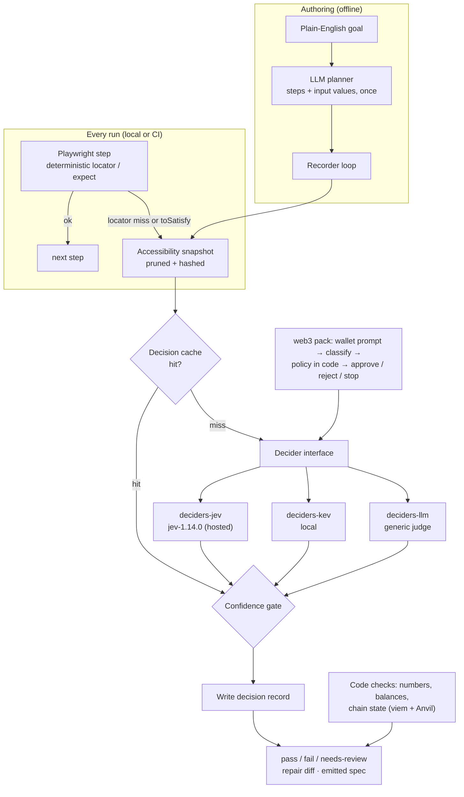

# Jevy — Design

Status: **M1, M2, and M3 are implemented.** `@jevyjs/core` has the Decider types, verdict gate, snapshot hash, redaction, config loader, and decision cache. `@jevyjs/deciders-jev`, `@jevyjs/deciders-kev`, and `@jevyjs/deciders-llm` implement the three adapters. Those match the sketches below except where [§12](#12-decisions-made-in-m1), [§13](#13-decisions-made-in-m2), and [§14](#14-decisions-made-in-m3) say otherwise. The recorder, Playwright plugin, and wallet pack are not implemented. TypeScript snippets outside §12–§14 are still signature sketches. Facts about third-party tools come from the project research notes (`RESEARCH.md` and `QA-APPROACHES.md`, 27 Oct 2026) and from the provider packages pinned in §14. Anything marked *(estimate)* is a guess.

## 1. Goals

1. **Useful with zero existing tests.** Turn a plain-English goal into a normal, readable Playwright spec (level 1).
2. **Improve existing Playwright suites.** Add semantic assertions with three verdicts and suggest locator repairs as reviewable diffs (level 2).
3. **Generate properties and invariants** that survive a mechanical filter: they compile and kill a mutant or a seeded bug (level 3, v0.2).
4. **Deterministic CI.** Every AI decision is recorded and replayed. Re-query only when the relevant part of the page changed.
5. **Swappable models.** One `Decider` interface. Jev (hosted), Kev (local, open-weight) and generic LLM adapters ship from day one. Switching between Jev and Kev is a one-line config change, per project or per test.
6. **Measured trust.** An `eval` command measures each decider on labelled cases (a published public set, plus the user's own) and recommends thresholds.
7. **Web3 as the flagship feature.** Wallet pop-ups are first-class test objects in any dApp the user tests. The signing policy lives in code, and chain state is checked in code.
8. **Product only.** The repo ships the packages. Users install them and configure Jevy for their own app, wallet, RPC and network. Demos are recorded videos, not code in the repo (section 5.4).

## 2. Non-goals

- **No other runners in v0.1.** Playwright only. API-level tests and Cypress may come later; mobile is not planned.
- **No new test runner.** We build on `@playwright/test` (latest at research time: v1.64.1, 14 Oct 2026).
- **No silent self-healing.** The research found silent heals hide regressions, and Playwright's own healer can loosen assertions or add `test.fixme()`.
- **No AI judgement of numbers, amounts, balances, dates, gas or chain state.** Jev's own docs say it is weak at maths, counting and date comparison ("keep the arithmetic in code").
- **No hosted cloud, dashboard or vendor test format.** Output is plain Playwright TypeScript.
- **No bundled example apps or site-specific code.** No Uniswap or other third-party app code lives in the repo. Package tests use small fixtures inside each package.
- **Not an AI auditor, and no replacement for human review or audits.**
- **No natural-language tests at runtime.** Natural language is an authoring input. What runs in CI is code plus recorded decisions.
- **No autonomous exploratory testing in v0.1.** The evidence rates it "promising, not a merge gate": the best of 15 agents found and fixed 59.0% of bugs on SWEeper-Bench.

## 3. Architecture



**Principles**
- Deterministic code always runs first.
- The decider is consulted only at defined decision points: choose an action and element, judge a semantic check, classify a wallet prompt, and later rank properties.
- Every decision is written to the cache before its result is used.

### 3.1 Level 1: `record`

1. **Plan (LLM, once).** The goal and the start URL go to an LLM that returns a short step plan and concrete input values (emails, amounts). Plans are cached, and the recorder doesn't call the LLM again unless re-planning is requested.
2. **Act (decider, every step).**
   - Take an accessibility snapshot.
   - Build candidates as *(action, element)* pairs, for example `click button "Pay"` or `fill textbox "Email" with <value>`. Prune them to at most 255, Jev's `choice` limit.
   - Ask the decider to pick one. Low confidence pauses the run for the user (interactive) or aborts it (non-interactive).
   - An element can only be one the page actually has, because Jev returns a typed option ID.
3. **Check.**
   - Semantic outcomes ("the dashboard is shown") are judged by the decider and emitted as `toSatisfy(...)`.
   - Anything numeric is emitted as a deterministic assertion (`toHaveText`, `toHaveValue`, or a viem read). Values come from the plan or from the user, never from an AI verdict.
4. **Emit.**
   - Write a Playwright spec using role-based locators (`getByRole`, `getByLabel`, `getByTestId` when present).
   - Write the recorded decisions to the cache.
   - The spec must run without Jevy's AI parts, except for `toSatisfy` lines, which replay from the cache.

### 3.2 Level 2: Playwright plugin

- **`expect(page | locator).toSatisfy(statement, opts?)`.** The decider's yes/no confidence maps to three verdicts, using thresholds set per project. `needs-review` is reported separately and can be set to fail or warn in CI.
- **Locator repair.** When a locator in a test from an existing suite fails, the plugin asks the decider to choose among accessibility-tree candidates. It attaches a suggested replacement locator as a unified diff to the report. The test still fails or is marked `needs-review`; the source file is never edited automatically.
- **Reporter.** A Playwright reporter lists `needs-review` items and repair diffs, and can write them as a patch file or a PR comment body. Posting is left to the user's CI.

### 3.3 Level 3: properties and invariants (v0.2, outline)

1. An LLM proposes properties in plain English from types, docs, NatSpec and audits.
2. They are translated into fast-check properties (TypeScript) or a Chimera-style shared suite (Foundry, Echidna, Medusa).
3. **Filter:** a property is kept only if it compiles, passes on the current code, and fails on at least one mutant or seeded bug. Seeds are stored for replay.
4. A decider may *rank* surviving properties for human review. It never decides whether a property is correct.

Echidna, Medusa and Halmos are AGPL-3.0, so they are invoked as external binaries and never bundled.

**v0.2 pilots.** Two public OSS projects, so results can be shared: viem (TypeScript, with fast-check) and OpenZeppelin Contracts (Solidity, with Foundry, Echidna and Medusa). Surviving properties would be offered upstream only through each project's normal contribution process.

## 4. Package layout (pnpm monorepo)

```
packages/
  core/            @jevyjs/core           Decider interface, cache, verdicts, snapshot pruning/hashing, config
  playwright/      @jevyjs/playwright     test/expect wrappers, toSatisfy, locator repair, reporter
  cli/             jevy (bin)           record, eval, cache, (v0.2) properties
  deciders-jev/    @jevyjs/deciders-jev   TypeSafe AI adapter (Vercel AI SDK + @ai-sdk/typesafe-ai)
  deciders-kev/    @jevyjs/deciders-kev   Kev adapter (same /v1/systemone wire shape, local URL)
  deciders-llm/    @jevyjs/deciders-llm   generic LLM judge (structured output; provider-agnostic)
  web3/            @jevyjs/web3           wallet prompt classes, policy, EIP-1193 mock, optional Anvil fork, viem helpers
docs/              design docs and user guides (setup for your own app, web3 config)
```

- **Test fixtures** (minimal static pages, a tiny local dApp page for the wallet pack) live inside each package's test folder and are not published as examples.
- **Eval.** The labelled-case schema ships with `@jevyjs/cli`. The public seed dataset may live in this repo or in a separate dataset repo, depending on snapshot licensing (OPEN-QUESTIONS).

**Naming.** Every package publishes under the `@jevyjs/*` scope. The CLI is `@jevyjs/cli` and installs a `jevy` command. (`@jevy` belongs to an unrelated npm user, and npm blocks the unscoped `jevy` as too similar to `jest` and `levn`; see OPEN-QUESTIONS.) The source lives at github.com/AdamGencel/jevy. Code is MIT.

**Dependency rules.**
- `core` has no model SDK dependencies. It does not import the decider packages.
- No hard dependency on a particular LLM vendor. `deciders-llm` takes either a user-supplied `LlmAdapter` or any Vercel AI SDK `LanguageModel`. `deciders-jev` is the only package that depends on TypeSafe's provider, and it is opt-in.
- Each decider is a separate package, so users install only what they use.
- `playwright` and `web3` depend on `core`, and on Playwright and viem as peer dependencies.

## 5. Key interfaces (sketches)

### 5.1 Decider

A decider answers typed questions about a state. Its shape mirrors Jev's question types (`choice`, `score`, `noul`) because they cover every decision point, and any LLM can emulate them with structured output.

```ts
type Question =
  | { kind: "choice"; prompt: string; options: { id: string; label: string }[] } // ≤ 255 options
  | { kind: "yesno"; prompt: string; criteria?: string }                          // Jev `noul`
  | { kind: "score"; prompt: string; levels: string[] };                          // 2–10 levels

interface Answer { value: string; confidence: number; probability?: number; raw?: unknown }

interface Decider {
  readonly id: string;     // e.g. "jev", "kev", "llm:<provider>/<model>"
  readonly model: string;  // pinned version, e.g. "jev-1.14.0"
  decide(state: DecisionState, questions: Record<string, Question>): Promise<Record<string, Answer>>;
}
```

- **`DecisionState`** is the pruned accessibility snapshot plus small structured context: URL, step goal, wallet prompt fields. Screenshots are off by default, because Jev image input is preview-only.
- **`confidence`** is how peaked the decider's belief is. It is not the probability of the chosen value. The gate reads confidence only. It is not trusted until `eval` has calibrated it.
- **`probability`** is the probability of the chosen value. It is stored on the answer and on the decision record, and it does not change the verdict.
- **Adapters** are implemented as described in §14. The sketch below is the call shape, not the wire format.
  - **Jev:** hosted, opt-in, pin `jev-1.14.0`, key from `TYPESAFE_API_KEY` at call time.
  - **Kev:** local System One server. Laptop default `kev-4b@v1.0`.
  - **LLM:** any AI SDK `LanguageModel`, or the config `LlmAdapter`. Structured output bounds each answer to the allowed values.

```ts
interface LlmAdapter { complete(prompt: string, jsonSchema: object): Promise<unknown> } // user-supplied
```

**Choosing a decider.** `selectDecider(config, override?)` resolves the id, model pin, base URL, key env name, and LLM adapter from config. It does not construct a client. `openDecider(config, { factories, mode })` turns that selection into a `Decider` by calling the factory for the selected id (`jevDeciderFromSelection`, `kevDeciderFromSelection`, or `llmDeciderFromSelection`). There is no default decider. Jev is used only when config or the override says `"jev"`. `test.use({ decider: "kev" })` is the Playwright form of the same override and lands in M4. The decider id and model pin are part of the cache key, so switching never reuses another model's decisions. In `replay` mode, `openDecider` does not call a factory.

### 5.2 Verdicts and the confidence gate

```ts
type Verdict = "pass" | "fail" | "needs-review";
interface Thresholds { pass: number; fail: number } // e.g. pass ≥ 0.8, fail < 0.5 (placeholders until eval)
```

The defaults are placeholders. `eval` suggests project-specific values.

M1 implements the gate as follows. A yes/no `yes` is `pass` only when its confidence is at least `pass`. A yes/no `no` is `fail` only when its confidence is at least `pass`. Any less sure yes or no is `needs-review`. The `fail` threshold does not apply to yes/no, and a weak answer is never taken as evidence for the opposite value. `fail` must still be strictly below `pass`, because a score uses both cuts: levels run from worst to best, shrink toward 0.5 as confidence drops, then `pass` at or above `pass`, `fail` below `fail`, and `needs-review` between them. A choice is `pass` only when confidence is at least `pass`, and is never `fail`. Choosing the inconclusive option (`__jevy_abstain`) is `needs-review` for every kind, whatever the confidence. Details are in §12 and §14.

### 5.3 Wallet pack

```ts
type WalletPromptKind =
  "connect" | "sign-message" | "sign-typed-data" | "send-transaction" |
  "approve-token" | "switch-network" | "add-network" | "unknown";

type PolicyDecision = "approve" | "reject" | "stop";
type WalletPolicy = (p: { kind: WalletPromptKind; decoded: DecodedRequest }) => PolicyDecision;
```

- The decider classifies only the prompt's *kind*.
- `decoded` holds the chain ID, recipient, value and calldata. It is parsed in code (viem) from the EIP-1193 request, never read by AI from the UI.
- The default policy stops on `unknown` and on anything that moves value without an explicit allow rule.
- **Two drivers:**
  - **Mock provider (default):** an injected EIP-1193 provider, announced through EIP-6963 and `window.ethereum`. It holds a user-supplied test key and forwards reads to the user's RPC. Fast and CI-friendly.
  - **Real extension, Synpress-style:** realistic, but needs headed mode or xvfb in CI.
- **Network is user-configured.** Jevy ships no RPC URLs, keys or chain defaults. The user picks one of:
  - **Local fork:** Jevy starts Anvil, forking from the user's RPC URL. Deterministic, with funds set by cheatcodes. Best for CI.
  - **Public testnet:** the user's own RPC and a faucet-funded throwaway key, for example Ethereum Sepolia (11155111) or Unichain Sepolia (1301).
  - **Any other chain**, with the same rules.
- **Never mainnet signing by default.** The mock provider refuses to sign or send on known mainnet chain IDs unless `allowMainnetSigning: true` is set explicitly, and a warning is shown even then. The default policy also stops on any value-moving request without an allow rule.
- **Keys:**
  - Keys are read only from environment variables, for example `JEVY_TEST_PRIVATE_KEY`.
  - Keys are redacted from decision records and reports.
  - Use throwaway keys that never hold real funds.

### 5.4 Demos (outside the product)

Demos are recorded videos used in the README and for promotion. They are not part of the repo, and their scripts are kept outside it.

- **Sites.** Real public web3 sites, Uniswap's web app first. The Uniswap app has a testnet mode for Sepolia and Unichain (per Uniswap's support docs).
- **How they're produced:**
  - Jevy runs against the live site with Playwright's `video: "on"` and `trace: "on"`, in a headed browser for a clean recording.
  - The trace viewer and Jevy's reporter output (verdicts, wallet prompt kind, policy decision, decoded amounts) are shown alongside, or as captions.
  - Each video is trimmed and captioned, and states the date and the Jevy version.
- **Safety:**
  - Testnet funds only, using a throwaway faucet-funded key.
  - Or run up to the wallet confirm screen and reject the signature: the policy returns `reject`, so nothing is broadcast.
  - Never mainnet, and never a key that has held real funds.
  - The key comes from the environment and must not appear on screen or in traces. Check traces before publishing.
- **Courtesy and terms:**
  - Keep request volume low.
  - Respect the site's terms of use.
  - Don't imply endorsement: each video states that Jevy isn't affiliated with the site.
- **Reproducibility.** Live sites change, so a demo is a point-in-time recording, not a test that CI depends on.

## 6. Decision cache format

**Location.** By default `.jevy/decisions/`, committed to git. One JSON Lines file per spec keeps diffs reviewable.

**Other storage.** For big suites, set `cache.dir` to another directory (a separate repo or a CI cache volume), or set `cache.store` to a `DecisionStore`. The store interface is `get`, `put`, `list`, `touch`, `replaceAll`, `noteReferenced`, and `referencedKeys`. `@jevyjs/core` ships `JsonlDecisionStore` (the default) and `MemoryDecisionStore`. There is no cloud backend. When `store` is set, it is used instead of `dir`. A string is not a store; a directory belongs in `dir`.

The default stays in git.

**Redaction before write.** Records pass through the same redaction rules as decider calls before they are written. By default those rules remove:
- strings that look like API keys, bearer tokens or private keys;
- seed phrases;
- email addresses and phone numbers;
- values of password and secret fields;
- any patterns the user adds.

A redaction pass that fails blocks the write. The concrete patterns, and the rule that redaction runs before hashing as well as before a write, are in §12.

**Key.** `sha256:` of canonical JSON `{ v, kind, prompt, criteria, goal, choices, snapshotHash, deciderId, model }`. `v` is the schema version. `prompt`, `criteria`, `goal`, and choice ids and labels are redacted and whitespace-collapsed before they are hashed. Absent criteria and goal hash as `""`. Choice order is the order in the question. `snapshotHash` is M1's `hashSnapshot` (`sha256:` of the redacted, normalised tree, or of one region). The decider id and model pin are part of the key, so a model change never reuses another model's answer. Spec path and step name are not part of the key: the same question on the same page can replay from another spec. The concrete field order is in §13.

**Record (one line, keys in this order):**

```json
{"v":1,"key":"sha256:…","spec":"tests/checkout.spec.ts","step":"toSatisfy#2",
 "kind":"yesno","question":"The page shows the order as confirmed","criteria":null,"goal":null,"choices":[],
 "snapshotHash":"sha256:…","decider":"jev","model":"jev-1.14.0","answer":"yes","confidence":0.93,"probability":0.8,"verdict":"pass",
 "thresholds":{"pass":0.8,"fail":0.5},"createdAt":"2026-10-27T22:00:00.000Z","lastUsedAt":"2026-10-27T22:00:00.000Z","reviewedBy":null}
```

**Rules**
- **Files are rewritten sorted**, by key, then `createdAt`, then spec, then step. One record per line. A directory lock and an atomic rename keep concurrent Playwright workers from tearing a line.
- **`record` overwrites** every line with that key. **`replay-or-query` appends** on a miss. `jevy cache prune` drops superseded lines and unused winners.
- **Human review is recorded.** `reviewDecision` appends a copy with `reviewedBy` set, and replay prefers a reviewed line. Review does not change confidence, so a low-confidence yes/no still replays as `needs-review`.
- **Replay re-gates.** The stored `verdict` is what the gate said at write time. A later read runs `gateAnswer` again with the caller's thresholds. A cached low-confidence yes or no is `needs-review`.
- **Model changes invalidate.** Changing the decider or model pin changes the key.
- **No secrets.** Records store hashes, redacted questions, and answers, not raw snapshots. A line that still matches a secret pattern is refused. Snapshots can optionally go to a gitignored debug folder.

## 7. CI story

| Mode | Behaviour on cache miss | Intended use |
|---|---|---|
| `replay` (CI default) | Step reports `needs-review` (or throws if the caller asked for an error); no network calls and no cache writes | PR checks: fully deterministic, no API keys needed |
| `replay-or-query` | On a hit, replay and refresh `lastUsedAt`. On a miss, query the decider, record, continue | Nightly or main-branch runs that refresh the cache |
| `record` | Always query, overwrite the key | Local authoring |

- **`needs-review` policy.**
  - Default: **warn on pull requests, fail on the main branch.** Configurable per project, for example `ci: { needsReview: { pr: "warn", main: "fail" } }`.
  - Branch detection uses standard CI environment variables, and the main branch name is configurable.
- PR runs are deterministic and need no model keys or network in `replay` mode.
- A changed page shows up as a cache miss, which is a reviewable signal rather than a silent AI call.
- A scheduled job in `replay-or-query` mode refreshes decisions and opens a PR with the updated cache and any repair diffs. Opening the PR is a user-configured CI step, not built in.
- Nondeterministic steps (LLM planning, exploratory runs) never sit in the blocking path.
- **Cost.** At Jev's published $0.042 per million input tokens (output free), a refresh run is likely cheap. Planning with a frontier LLM costs more, but only at authoring time. *(estimate; depends on page size and run count)*

## 8. Eval harness

**Command.** `jevy eval --cases eval/cases.jsonl --deciders jev,kev,llm [--repeat 3]`

**Case format.** One labelled decision per line: the state (or a path to a saved snapshot), the question, the expected answer and the source app. The same schema serves the user's own cases.

**Public seed dataset.**
- About 200 labelled cases, taken only from public apps (the Uniswap web app and other public sites).
- Published so anyone can rerun the benchmark on Jev, Kev or their own LLM: in this repo, or in a separate dataset repo if the licensing of site snapshots is a concern (OPEN-QUESTIONS).
- Snapshots are captured from public pages and run through redaction.
- Results are reported per decider with the exact model pin, for example `jev-1.14.0` or `kev-4b@v1.0`.
- Contributors without a Jev key can still rerun it on Kev.

**Metrics.** Per decider and per question kind:
- Accuracy and TPR/TNR (the practitioner standard for binary judges).
- Precision on `fail` verdicts.
- Calibration (reliability table and Brier score).
- `needs-review` rate at the suggested thresholds.
- p50 and p95 latency, cost per 1,000 decisions, and run-to-run disagreement over `--repeat`.

**Output.** A markdown and JSON report plus recommended thresholds.

**Precision bar for advisory AI steps.** An advisory step, such as locator-repair suggestions, failure triage (v0.2) or a nightly exploratory run (v0.3), stays switched on only if **at least 70% of its findings are accepted as real**.
- Acceptance is measured from review outcomes (`reviewedBy` and accept/reject) recorded in the decision cache.
- `jevy eval` and `jevy cache stats` report it per step.
- A step that falls below 70% over a configurable window is flagged for switching off.

**Why it's mandatory.** Red Hat's benchmark of Jev-1.13.0 (2 Oct 2026) found decision models "do not reliably outperform LLM-as-a-judge … in speed or accuracy" on guardrail tasks. That result is disputed on HN, and guardrail tasks aren't testing tasks, so the default decider should be whichever wins on the user's own cases.

## 9. Security and privacy

- **Data leaves the machine** with hosted deciders. Jev is a closed, hosted model served from the US. TypeSafe states customer data isn't used for training, but zero data retention is enterprise-only. **Project policy:** Jev is acceptable for staging and public apps. For anything more sensitive, switch to local Kev with one config line, per project or per test. Snapshots from staging may still contain PII, tokens or internal data. Mitigations:
  - Redaction rules in `core`, applied before any decider call.
  - Screenshots off by default.
  - A `--decider kev` path that keeps everything local.
  - Hosted deciders must be enabled explicitly per project.
- **Look-alike Jev domains.** Third-party sites such as jevtypesafeai.com, aijev.app, madewithjev.com and jevlaya.cc proxy the API or sell "instant hosted keys". The Jev adapter will:
  - Default to `https://api.typesafe.ai`.
  - Accept only an allow-list of base URLs: the official API, Vercel AI Gateway, OpenRouter, or a user-declared Kev URL.
  - Warn loudly on anything else.
  - Docs will link only typesafe.ai and docs.typesafe.ai.
- **Prompt injection.** Page content is untrusted input to the decider; Jev's docs note it can be swayed by adversarial state. Mitigations:
  - A decider can only choose among options the code built.
  - Wallet actions go through the code policy, and `unknown` stops the run.
  - No decider output is ever executed as code.
- **Keys and wallets.**
  - API keys come from environment variables (`TYPESAFE_API_KEY` for Jev; the user's own variables for their LLM adapter). They are never written to the cache, reports, traces or demo recordings.
  - The repo will ship a `.gitignore` covering `.env*`, and CI will use secret storage.
  - Contributors must never commit keys; see CONTRIBUTING.
  - The wallet pack uses user-supplied throwaway keys, from environment variables, on a network the user configures (a local fork or a testnet).
  - Mainnet signing is refused unless `allowMainnetSigning: true` is set explicitly, and the default policy stops value-moving requests without an allow rule.
- **Supply chain.** Pin the deciders' SDK versions. AGPL tools stay external binaries.
- **Model drift.** Pin `jev-1.14.0`. Moving aliases are rejected by default, and a model change invalidates cache keys.

## 10. Configuration sketch

```ts
// jevy.config.ts (sketch)
export default defineConfig({
  decider: { use: "jev", model: "jev-1.14.0", fallback: ["kev", "llm"] }, // shorthand: decider: "kev"
  deciders: {
    jev: { apiKeyEnv: "TYPESAFE_API_KEY" },
    kev: { baseUrl: "http://127.0.0.1:8009", model: "kev-4b@v1.0" },
    llm: { adapter: myLlmAdapter },                 // any provider, user-supplied
  },
  thresholds: { pass: 0.8, fail: 0.5 },          // replace with eval output
  cache: { dir: ".jevy/decisions", mode: process.env.CI ? "replay" : "record" }, // or store: externalStore(...)
  ci: { needsReview: { pr: "warn", main: "fail" }, mainBranch: "main" },
  redact: [/sk_live_\w+/, { role: "textbox", name: /password/i }],
  web3: {
    driver: "mock",
    chain: { id: 11155111, rpcUrlEnv: "SEPOLIA_RPC_URL" },   // or { fork: { rpcUrlEnv: "FORK_SOURCE_RPC_URL" } }
    account: { privateKeyEnv: "JEVY_TEST_PRIVATE_KEY" },
    policy: "./wallet-policy.ts",
    allowMainnetSigning: false,                              // default
  },
});
```

`loadConfig` in `@jevyjs/core` accepts this shape. Differences from the sketch are in §12 and §13. `cache.store`, when set, is a `DecisionStore` object, not a path.

## 11. Known risks

- **Jev maturity and access.** It launched 15 Sep 2026 and is in early access; the HN thread reported that signups were closed. The maintainer has a direct API key, but many users and contributors won't. Kev and the LLM adapters are the exit, and the project and its public benchmark must work without Jev.
- **Calibration** is disputed for Jev and unknown for LLM proxies. Use `eval` and three verdicts.
- **Competition.** Playwright's agents or vendors such as Momentic may add similar features. The differentiators are calibration, deterministic replay, the Web3 pack and plain code output.
- **Demos depend on live sites.** A site redesign or testnet outage can break a recording session. Demos are point-in-time and never gate CI.
- **Wallet automation is brittle.** Synpress documents headless issues. Default to the mock provider and keep the real-extension driver for smoke tests.
- **Level 3 evidence is mostly from Python** (Hypothesis). Whether it works as well with TypeScript and fast-check is unproven.

## 12. Decisions made in M1

`@jevyjs/core` has no model SDK and makes no network calls. `fakeDecider` answers without a network. The real adapters are §14. The decision cache is §13. `hashSnapshot` is the snapshot half of the cache key.

### 12.1 Types

- The question kind is `yesno`, as in the §5.1 sketch. Jev's wire type `noul` is for the adapter to map.
- `LlmAdapter` is declared here so config can hold one. `llmDecider()` is not implemented.
- `DecisionState` is the accessibility snapshot plus optional `url`, `goal`, and `wallet` fields. There is no screenshot field. `prepareDecisionState` throws if a `screenshot` property is present.
- The snapshot is a structured tree in the shape of Playwright's accessibility snapshot (`role`, `name`, `value`, states, `children`). YAML aria snapshots are not accepted. Core does not depend on Playwright.
- `callDecider` redacts and prunes, then calls `Decider.decide`. That is the supported way to hand a page to a decider.

### 12.2 Verdicts

Yes/no confidence is how sure the decider is of the value it returned. The gate does not convert that into P(the statement holds), and it does not flip a weak answer into the opposite verdict.

- A `yes` is `pass` only when confidence >= `pass`. With the defaults, `yes` at 0.8 or 0.93 passes. `yes` at 0.79 or 0.25 is `needs-review`.
- A `no` is `fail` only when confidence >= `pass`. That is a confident no. With the defaults, `no` at 0.8 or 0.93 fails. `no` at 0.79 or 0.125 is `needs-review`.
- Anything below `pass` is `needs-review`, whether the value is `yes` or `no`, and whether confidence sits between `fail` and `pass` or below `fail`.

The `fail` threshold does not change a yes/no verdict. Using it as a cut on P(yes) was the rule that flipped a `no` at 0.125 into `pass` (because `1 - 0.125 = 0.875`) and that failed a weak `yes`. Both are rejected: uncertainty is `needs-review`, not evidence for the other answer, and not a product failure. Projects may still set `fail`. Two different `fail` values with the same `pass` produce the same yes/no verdict. `fail` must remain strictly below `pass` because score verdicts use the band between them.

Score levels are ordered from worst to best. The chosen level is a position from 0 to 1, then moved toward 0.5 by `(1 - confidence)`. The adjusted position is `pass` when it is >= `pass`, `fail` when it is < `fail`, and `needs-review` in between. That is a point on an ordered scale. It is not the yes/no rule, and it does not invert a boolean answer.

A choice must name one of the option ids. Confidence at or above `pass` accepts it (`pass`); anything lower is `needs-review`. A choice is never `fail`. The `fail` threshold does not apply. More than 255 options, or a score outside 2 to 10 levels, throws. Core does not drop options to fit the cap.

### 12.3 What the hash covers

`hashSnapshot` returns `sha256:` and 64 hex characters. The payload is canonical JSON `{ v: 1, tree }` of the redacted, normalised tree, or of one region of it. Pruning does not affect the hash: a node removed only to fit a token budget still changes the hash when the page changes. The URL is not part of the snapshot hash. It is redacted before it would be sent.

The same hash:

- Key order, collapsed whitespace, and `children: []` versus no children.
- `focused`, and fields outside the allow-list (`autocomplete`, `orientation`, `multiline`, `haspopup`, `keyshortcuts`, and the other presentational flags).
- Inner `none` and `presentation` nodes, and unnamed `generic` nodes. Their children are promoted. The root node is kept.
- Timestamps that include a time (`2026-10-28T01:02:03Z`), relative times (`3 seconds ago`), UUIDs, and runs of 8 or more digits.

A new hash:

- Accessible name, role, added or removed nodes.
- `checked`, `pressed`, `expanded`, `selected`, `disabled`, `required`, `readonly`, `modal`, heading `level`, and a numeric `value`.
- A bare calendar date (`Due 2026-10-28`). Dates without a time are treated as content.
- A short number (`Order 42`). Long digit runs are the volatile ones.

A region is `{ role, name? }`, matched on the normalised tree, first hit in tree order. The caller's name is normalised the same way. A miss throws, instead of hashing the whole page.

`normalise.disable` can turn off `uuid`, `timestamp`, `relative-time`, or `long-digits`. Extra `replace` patterns and `dropRoles` are added. `none` and `presentation` always drop.

The token estimate is `ceil(canonicalJson.length / 4)`. It is not a model tokenizer. Default prune limits are 400 nodes, depth 16, and 12,000 tokens. Kev uses 6,000 tokens so a question still fits in the 8,192-token window. Deepest leaves go first; ties go to the rightmost path. The root stays. If the root name alone exceeds the budget, it is shortened. `truncated` is reported and is not hashed.

### 12.4 Redaction

Redaction runs inside `hashSnapshot`, `prepareDecisionState`, and `callDecider`. Built-in rules always run. `redact` in config adds rules. If a second pass still matches a secret pattern, `RedactionError` is thrown and nothing is returned.

Built-ins remove PEM private keys, AWS access keys, GitHub tokens, Slack tokens, Stripe-style keys, `sk-` keys, bearer tokens, `api_key=` / `password=` assignments, email addresses, and common phone numbers. Seed phrases are 12, 15, 18, 21, or 24 words from the BIP-39 English wordlist, which is vendored for that check only.

`0x` followed by 64 hex characters is treated as an Ethereum private key and redacted. A 40-hex address is not: addresses are public and are often the thing under test. A transaction hash has the same shape as a private key, so it is redacted too. That is the tradeoff to confirm.

A textbox or searchbox whose name or autocomplete says password, secret, API key, mnemonic, or private key has its value replaced. The accessible name stays, so the hash still shows that the control exists. The replacement token is `[REDACTED]`, so two secrets in the same place hash the same. Wallet field names matching key, secret, seed, mnemonic, password, or token are replaced entirely.

### 12.5 Config

`defineConfig` only types the object. `loadConfig` executes `jevy.config.ts`, then `.mts`, `.js`, or `.mjs`, using Node's type stripping, and `parseConfig` checks the result. Unknown keys throw. A missing file throws. There is no default decider: a hosted model is selected only by writing `decider: "jev"` or by passing an override. `decider: "kev"` is the one-line local switch. `selectDecider(config, "kev")` is the per-test override this package can apply. Playwright's `test.use` is M4 and will call the same function. An override does not reuse the project's model pin or fallback list. Fallback ids are checked and stored. Nothing calls them.

When Jev is selected and unconfigured, the pin is `jev-1.14.0`, the base URL is `https://api.typesafe.ai`, and the key is read later from `TYPESAFE_API_KEY`. The loader stores that name and does not read the value. Kev defaults to `kev-4b@v1.0` at `http://127.0.0.1:8009`. An LLM decider requires `deciders.llm.adapter.complete` and an explicit `model`.

`jev-latest` and `jev-preview`, including a `~typesafe/` or other author prefix, are rejected unless `deciders.jev.allowMovingAlias` is true. A Jev base URL must be https and one of `https://api.typesafe.ai`, `https://openrouter.ai/api`, or `https://ai-gateway.vercel.sh/typesafe`. Kev accepts any http(s) URL without credentials. The allow-list is also on the M3 adapter list; config rejects a look-alike host before an adapter exists.

`cache.dir` defaults to `.jevy/decisions`. `cache.mode` is `replay` when `CI` is set and is not `""`, `"0"`, or `"false"`; otherwise `record`. `cache.store` is optional. When it is set it must be a `DecisionStore`; a path or any other value throws, and the message points at `cache.dir`. `ci.needsReview` defaults to warn on pull requests and fail on `main`.

`web3` is optional. When present, `driver` defaults to `"mock"` and `allowMainnetSigning` defaults to false. A known mainnet chain id adds a warning. The wallet pack does not exist yet; the warning records the intended refusal. `privateKeyEnv` and `rpcUrlEnv` must be variable names. A pasted key fails validation. `snapshotOptionsFromConfig` passes the loaded redact rules and normalisation into the hash.

## 13. Decisions made in M2

The decision cache lives in `@jevyjs/core`. `resolveDecision` is the supported way to replay or record one answer. `@jevyjs/cli` adds `jevy cache stats` and `jevy cache prune`. Nothing in this milestone calls a network API. The CI fixture stubs `globalThis.fetch` (Node's undici fetch) and `http`/`https` `request`, then asserts they were not called.

### 13.1 Key

`DECISION_SCHEMA_VERSION` is `1`. It is both the record's `v` and the `v` inside the hashed payload. The payload is JSON with this key order: `v`, `kind`, `prompt`, `criteria`, `goal`, `choices`, `snapshotHash`, `deciderId`, `model`. Choice entries are `{ id, label }` in question order. A yes/no question has no choices. A score's levels are stored as choices whose id and label are the level text.

Strings are passed through M1 `redactText` before hashing, so the key is computed from redacted text and the unredacted text is not stored. Whitespace-only differences in the prompt hit. A different goal, criteria, choice label, snapshot hash, decider id, model, kind, or schema version misses.

The snapshot half is `hashSnapshot`. Pruning still does not affect it. A region passed to `resolveDecision` is hashed the same way as in M1. Cosmetic changes that M1 already ignores (timestamps with a time, relative times, UUIDs, runs of 8 or more digits) hit the cache. A renamed control or a `checked` change misses, because those change the snapshot hash. A renamed choice label also misses, even when the snapshot is unchanged.

Spec and step are stored on the record and are not part of the key.

### 13.2 Files

The default directory is `.jevy/decisions`. One JSONL file per spec, under the relative spec path with each segment URI-encoded, plus `.jsonl`. `tests/checkout.spec.ts` is `tests/checkout.spec.ts.jsonl`. Absolute paths and `..` segments throw. The snapshot is not in the file.

Each line is `serialiseDecisionRecord`. Object keys are the field list in §6, not alphabetical. The file is sorted by key, then `createdAt`, then spec, then step, and ends with a newline. Blank lines are ignored on read. A malformed line or an unknown field throws `CacheError` and the line is not echoed, so a hand-edited secret does not land in the error text.

Writes take an in-process queue per directory and a cross-process lock directory, `.jevy/decisions/.locks`, then write a temp file in the same directory and `rename` it over the target. That is the concurrency approach: one sorted file per spec, not a shard per Playwright worker. A crashed lock is stolen once its pid is gone, or after a second if it never wrote a pid. `.locks/`, `*.tmp`, and `.last-run.json` are gitignored. The JSONL is meant to be committed.

### 13.3 Modes

`cache.mode` defaults are unchanged from M1: `replay` when `CI` is set and is not `""`, `"0"`, or `"false"`, otherwise `record`.

- **`replay`.** Read only. A hit re-gates the stored answer with the caller's thresholds (or the defaults). A miss returns `needs-review` and does not call the decider. `onMiss: "error"` throws `CacheMissError` instead, still with no decider call. Replay does not update `lastUsedAt` and does not write `.last-run.json`, so a CI run does not dirty git.
- **`replay-or-query`.** A hit updates `lastUsedAt` on the winning line and notes the key. A miss calls the decider through `callDecider` (redacted and pruned) and appends a line.
- **`record`.** Always calls the decider and replaces every stored line with that key.

`openDecisionStore` returns `cache.store` when it is set, otherwise a `JsonlDecisionStore` for `cache.dir`.

### 13.4 No-flip, review, prune, stats

A cached yes/no is passed through `gateAnswer` on every read. Confidence below `pass` is `needs-review` for both `yes` and `no`. The stored `verdict` string is not trusted: a line that says `pass` with confidence `0.25` replays as `needs-review`. Caller thresholds win over the thresholds saved on the line, so raising `pass` can turn an old hit into `needs-review` without a new query.

`reviewDecision(store, key, name)` appends a copy with `reviewedBy` set. Replay prefers a reviewed line over a newer unreviewed one. The copy keeps the original confidence, so review does not promote a weak answer to pass or fail. A reviewer value that redacts to `[REDACTED]` (an email address, for example) is rejected and not written.

`jevy cache prune` keeps one winning line per key and always drops the others. It then drops that winner when asked:

- **`--days <n>`.** `<n>` is an integer >= 0. The winner is unused when `lastUsedAt` is at or before `now` minus `<n>` times 24 hours. `lastUsedAt` is set when the line is written and when `replay-or-query` hits. Replay does not refresh it.
- **`--not-referenced`.** The winner is unused when its key is absent from `.jevy/decisions/.last-run.json`. That file is updated only by `record` and `replay-or-query`. A CI replay does not change it. The file is gitignored.

Passing both flags, or neither, is an error. There is no default age.

`jevy cache stats` prints line counts, unique keys, specs, superseded lines, reviewed lines, stored verdicts, kinds, and deciders. Acceptance is `reviewed / total` among winning lines whose stored verdict is `needs-review`, overall and per `spec` + `step`. Zero such lines print `acceptance overall: n/a`. That ratio is the cache's view of the advisory-step acceptance bar in §8. It does not by itself switch a step off.

### 13.5 Store interface

```ts
interface DecisionStore {
  get(key: string): Promise<DecisionRecord | null>; // winning line
  put(record: DecisionRecord, options?: { replace?: boolean }): Promise<void>;
  list(spec?: string): Promise<readonly DecisionRecord[]>;
  touch(key: string, lastUsedAt: string): Promise<void>;
  replaceAll(records: readonly DecisionRecord[]): Promise<void>;
  noteReferenced(key: string, at: string): Promise<void>;
  referencedKeys(): Promise<ReadonlySet<string>>;
}
```

`get` returns the newest reviewed line for the key, or the newest line if none is reviewed. `put` appends unless `replace` is set, in which case every line with that key is removed first. Both implementations refuse a record whose JSON still matches a redaction pattern, so a caller that skipped redaction cannot write the secret. `MemoryDecisionStore` keeps the same rules in memory. `JsonlDecisionStore` is the filesystem implementation. No cloud backend is included.

## 14. Decisions made in M3

The three adapters live in their own packages. `@jevyjs/core` still has no model SDK. `selectDecider` returns the selection (id, model pin, base URL or adapter). `openDecider` calls the factory the application passed in for that id. A missing factory throws `ConfigError` and names `@jevyjs/deciders-<id>`. There is no default decider.

### 14.1 Inconclusive option, probability, and confidence

Every question sent to a model includes an explicit inconclusive option, id `__jevy_abstain`. A caller cannot use that id as a choice id or a score level. A choice may have at most 254 caller options, because the 255th slot is abstain. Picking abstain returns `value: "__jevy_abstain"`, and `gateAnswer` returns `needs-review` before the kind-specific rules. The no-flip rule is unchanged: pass only on a confident yes, fail only on a confident no, and a weak answer is `needs-review`.

Yes/no and score are sent as a System One `choice` whose options are the levels (or yes and no) plus abstain. Native `noul` returns only the probability of true and has no confidence field, so using it would force confidence to 0 and never pass. Native `score` has confidence but no abstain slot. Fractional scores are not returned; the answer value is one of the level strings, which is what M1 already required.

`probability` is the probability of the picked option, or 0 when that number is missing or outside 0–1. `confidence` is the separate peakedness score, or 0 when it is missing, null, or outside 0–1. The gate still reads confidence only. A high probability with no confidence is `needs-review`. Both numbers are stored on the decision record. The cache key payload is unchanged, so `DECISION_SCHEMA_VERSION` stays `1`. The line field order gained `probability` immediately after `confidence`. M2 has not been released; a JSONL file written by the M2 code will fail to parse. When an in-memory answer omits `probability`, `resolveDecision` stores `answer.confidence` in that field.

How each decider fills the two numbers:

- **Jev.** `experimental_decide` returns a choice distribution. `probability` is `answers[name].probabilities[picked]`. `confidence` is `providerMetadata.typesafe.confidence[name]`. TypeSafe describes confidence as peakedness: a flat distribution is low, a single peak is high, and it can be lower than the probability of the chosen option.
- **Kev.** The local server is asked the same choice shape. `probability` is the picked entry of `probabilities`. `confidence` is the `confidence` number on that answer. A missing confidence is 0.
- **LLM.** Structured output asks the model for `value`, `probability`, and `confidence` as separate fields. `value` is an enum of the allowed ids, including abstain. `probability` is the model's number for the picked value. `confidence` is the model's separate 0–1 score. A value outside the enum is a transport error, not a verdict.

The inconclusive option, and the split between probability and confidence, are ideas also used by the decision executor in TesterArmy's e2e (Apache-2.0). The prompts, thresholds, and client code here were written independently and were not copied from that project.

### 14.2 Jev

Jev uses the Vercel AI SDK `ai@7.0.162` and the TypeSafe provider `@ai-sdk/typesafe-ai@3.0.33` (`createTypeSafeAi` and `experimental_decide`). It does not use `@typesafe-ai/sdk`, and it does not hand-roll the HTTP client. Both versions are pinned in `@jevyjs/deciders-jev`.

The provider posts to `{baseURL}/systemone`. The official TypeSafe HTTP API posts to `{base}/v1/systemone`, and the M1 allow-list entries do not include `/v1`. The adapter checks the allow-list first (`https://api.typesafe.ai`, `https://openrouter.ai/api`, `https://ai-gateway.vercel.sh/typesafe`), then appends `/v1` and passes that as `baseURL`. The user's key is passed in `createTypeSafeAi({ apiKey, baseURL })`. The call goes to TypeSafe (or another allow-listed host) with that key. Jevy does not proxy or resell it.

The key is read only inside `decide`, from the env name on the selection, which defaults to `TYPESAFE_API_KEY`. `TYPESAFE_AI_API_KEY` is not accepted. Construction does not read the key. The provider module is imported dynamically inside the attempt, so building the decider, and replay, do not load it. `maxRetries` on the SDK call is 0; retries are the shared wrapper below. The key is redacted from error text and is not logged.

A moving alias (`jev-latest`, `jev-preview`, including an author prefix) is rejected unless `allowMovingAlias` is set. When the pin is a concrete model and the response `modelId` differs, the answer is discarded and the call throws. When `allowMovingAlias` is set, the response model is accepted and the cache pin stays the requested alias.

### 14.3 Kev

Kev talks HTTP to a local System One server. The default base is `http://127.0.0.1:8009`, which is Kev's own server (`uv run --extra serve python -m kev.serve --run jaredpalmer/kev-4b@v1.0 --port 8009`). That server accepts `kev-latest` (and `jev-latest`) as the HTTP `model` field; the hub pin is the checkpoint the process was started with, and the server does not report which checkpoint is loaded. `Decider.model` stays the pin (`kev-4b@v1.0` by default) so the cache key names the checkpoint. The request body uses `kev-latest` unless `requestModel` is set (for an Ollama tag, for example). Port `11434` gets an error that mentions Ollama.

If the connection is refused, the error includes that `uv` command and the port, and it is retryable. It is never a pass or a fail. `KEV_API_KEY` is optional. When it is set, the request sends `Authorization: Bearer`, and the value is redacted from errors. The server is open when that variable is unset.

`decide` throws `QuestionError` when `estimateSnapshotTokens` is over `KEV_SNAPSHOT_TOKEN_BUDGET` (6000). `callDecider` and `resolveDecision` already prune to 6000 when the decider id is `"kev"` (the validated context is 8192). A direct `decide` on an unpruned snapshot does not.

### 14.4 LLM

`llmDecider({ languageModel, model })` accepts any AI SDK `LanguageModel`. `model` is the pin stored on the decider and in the cache key. The id defaults to `llm:<model>`. Structured output uses `generateText` with `Output.object` and `jsonSchema`. The `ai` package is imported only on this path, and only inside the attempt. `maxRetries` is 0.

`llmDecider({ adapter, model })` uses the M1 `LlmAdapter.complete(prompt, jsonSchema)` instead, which is what `deciders.llm` in config stores. That path does not import `ai`. `llmDeciderFromSelection` builds this form, with id `llm:<model>`.

The prompt tells the model that the state is untrusted, that it must pick one allowed value, that the inconclusive value is for insufficient evidence, and that probability and confidence are different numbers. A low probability is not a vote for the opposite value.

### 14.5 Retries, timeouts, and replay

`retryWithBackoff` runs 3 attempts by default. The first backoff is 200ms and then doubles. Each attempt has its own timeout: 20s for Jev, 60s for Kev, 45s for the LLM decider. HTTP 408, 429, 500, 502, 503, and 529 are retried. HTTP 401 is not. A timeout is retryable. A network or protocol failure throws `DeciderTransportError`. It is not cached and it is not a pass or a fail. Callers can treat that error as `needs-review` or surface it.

`openDecider(config, { mode: "replay" })` returns a decider whose `id` and `model` come from `selectDecider` and whose `decide` rejects with `DeciderTransportError`. The factory is not called, so no network client is constructed. `resolveDecision` in replay mode does not call `decide` on a cache hit or a miss.

### 14.6 Tests

Unit tests mock `fetch` or the adapter. `pnpm test` excludes `*.live.test.ts`. `pnpm test:live` runs `packages/deciders-jev/src/jev.live.test.ts`, which calls TypeSafe only when `TYPESAFE_API_KEY` is set and skips otherwise. CI runs `pnpm test` and does not run the live file.

### 14.7 Still open

These are recorded so they can be decided later. The code does not guess past them.

- The gate uses confidence only, not `min(confidence, probability)`.
- Yes/no and score are encoded as choice so abstain exists and so a missing noul confidence does not zero every yes/no.
- The Kev server cannot prove the running checkpoint matches the pin. The wire model is `kev-latest`.
- Kev-4B latency on a MacBook has not been measured. The roadmap exit criterion stays open.
- With `allowMovingAlias`, the cache key uses the alias, not the model id the server resolved.
- Adding required `probability` to schema version 1 rejects JSONL written by the M2 code. That code has not been released.
- TypeSafe confidence is peakedness, so a peaked yes can have confidence below the probability of yes. The published example is probability 0.61 with confidence 0.42, which this gate treats as `needs-review` at the default 0.8 pass threshold.
- `TYPESAFE_AI_API_KEY`, the provider's own env name, is not read. Only `TYPESAFE_API_KEY` is.
