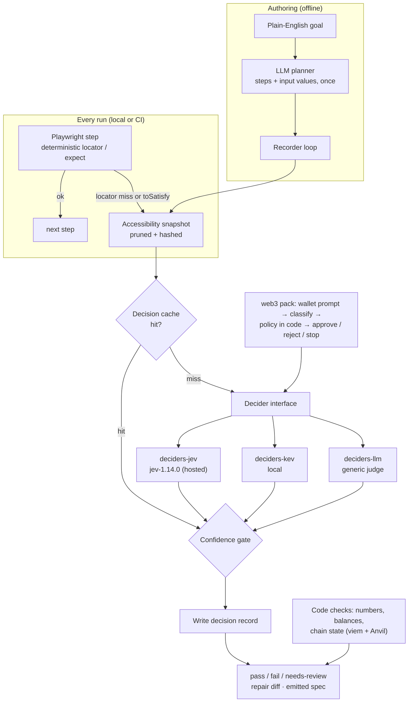

# Jevy — Design

Status: **design stage, no implementation.** This document describes intended behaviour. TypeScript snippets are signature sketches, not code to copy. Facts about third-party tools come from the project research notes (`RESEARCH.md` and `QA-APPROACHES.md`, 27 Oct 2026). Anything marked *(estimate)* is a guess.

## 1. Goals

1. **Useful with zero existing tests.** Turn a plain-English goal into a normal, readable Playwright spec (level 1).
2. **Improve existing Playwright suites.** Add semantic assertions with three verdicts and suggest locator repairs as reviewable diffs (level 2).
3. **Generate properties and invariants** that survive a mechanical filter: they compile and kill a mutant or a seeded bug (level 3, v0.2).
4. **Deterministic CI.** Every AI decision is recorded and replayed. Re-query only when the relevant part of the page changed.
5. **Swappable models.** One `Decider` interface. Jev (hosted), Kev (local, open-weight) and generic LLM adapters ship from day one. Switching between Jev and Kev is a one-line config change, per project or per test.
6. **Measured trust.** An `eval` command measures each decider on labelled cases (a published public set, plus the user's own) and recommends thresholds.
7. **Web3 as the flagship feature.** Wallet pop-ups are first-class test objects in any dApp the user tests. The signing policy lives in code, and chain state is checked in code.
8. **Product only.** The repo ships the packages. Users install them and configure Jevy for their own app, wallet, RPC and network. Demos are recorded videos, not code in the repo (section 5.4).

## 2. Non-goals

- **No other runners in v0.1.** Playwright only. API-level tests and Cypress may come later; mobile is not planned.
- **No new test runner.** We build on `@playwright/test` (latest at research time: v1.64.1, 14 Oct 2026).
- **No silent self-healing.** The research found silent heals hide regressions, and Playwright's own healer can loosen assertions or add `test.fixme()`.
- **No AI judgement of numbers, amounts, balances, dates, gas or chain state.** Jev's own docs say it is weak at maths, counting and date comparison ("keep the arithmetic in code").
- **No hosted cloud, dashboard or vendor test format.** Output is plain Playwright TypeScript.
- **No bundled example apps or site-specific code.** No Uniswap or other third-party app code lives in the repo. Package tests use small fixtures inside each package.
- **Not an AI auditor, and no replacement for human review or audits.**
- **No natural-language tests at runtime.** Natural language is an authoring input. What runs in CI is code plus recorded decisions.
- **No autonomous exploratory testing in v0.1.** The evidence rates it "promising, not a merge gate": the best of 15 agents found and fixed 59.0% of bugs on SWEeper-Bench.

## 3. Architecture



**Principles**
- Deterministic code always runs first.
- The decider is consulted only at defined decision points: choose an action and element, judge a semantic check, classify a wallet prompt, and later rank properties.
- Every decision is written to the cache before its result is used.

### 3.1 Level 1: `record`

1. **Plan (LLM, once).** The goal and the start URL go to an LLM that returns a short step plan and concrete input values (emails, amounts). Plans are cached, and the recorder doesn't call the LLM again unless re-planning is requested.
2. **Act (decider, every step).**
   - Take an accessibility snapshot.
   - Build candidates as *(action, element)* pairs, for example `click button "Pay"` or `fill textbox "Email" with <value>`. Prune them to at most 255, Jev's `choice` limit.
   - Ask the decider to pick one. Low confidence pauses the run for the user (interactive) or aborts it (non-interactive).
   - An element can only be one the page actually has, because Jev returns a typed option ID.
3. **Check.**
   - Semantic outcomes ("the dashboard is shown") are judged by the decider and emitted as `toSatisfy(...)`.
   - Anything numeric is emitted as a deterministic assertion (`toHaveText`, `toHaveValue`, or a viem read). Values come from the plan or from the user, never from an AI verdict.
4. **Emit.**
   - Write a Playwright spec using role-based locators (`getByRole`, `getByLabel`, `getByTestId` when present).
   - Write the recorded decisions to the cache.
   - The spec must run without Jevy's AI parts, except for `toSatisfy` lines, which replay from the cache.

### 3.2 Level 2: Playwright plugin

- **`expect(page | locator).toSatisfy(statement, opts?)`.** The decider's yes/no confidence maps to three verdicts, using thresholds set per project. `needs-review` is reported separately and can be set to fail or warn in CI.
- **Locator repair.** When a locator in a test from an existing suite fails, the plugin asks the decider to choose among accessibility-tree candidates. It attaches a suggested replacement locator as a unified diff to the report. The test still fails or is marked `needs-review`; the source file is never edited automatically.
- **Reporter.** A Playwright reporter lists `needs-review` items and repair diffs, and can write them as a patch file or a PR comment body. Posting is left to the user's CI.

### 3.3 Level 3: properties and invariants (v0.2, outline)

1. An LLM proposes properties in plain English from types, docs, NatSpec and audits.
2. They are translated into fast-check properties (TypeScript) or a Chimera-style shared suite (Foundry, Echidna, Medusa).
3. **Filter:** a property is kept only if it compiles, passes on the current code, and fails on at least one mutant or seeded bug. Seeds are stored for replay.
4. A decider may *rank* surviving properties for human review. It never decides whether a property is correct.

Echidna, Medusa and Halmos are AGPL-3.0, so they are invoked as external binaries and never bundled.

**v0.2 pilots.** Two public OSS projects, so results can be shared: viem (TypeScript, with fast-check) and OpenZeppelin Contracts (Solidity, with Foundry, Echidna and Medusa). Surviving properties would be offered upstream only through each project's normal contribution process.

## 4. Package layout (pnpm monorepo)

```
packages/
  core/            @jevy/core           Decider interface, cache, verdicts, snapshot pruning/hashing, config
  playwright/      @jevy/playwright     test/expect wrappers, toSatisfy, locator repair, reporter
  cli/             jevy (bin)           record, eval, cache, (v0.2) properties
  deciders-jev/    @jevy/deciders-jev   TypeSafe AI adapter (wraps @typesafe-ai/sdk)
  deciders-kev/    @jevy/deciders-kev   Kev adapter (same /v1/systemone wire shape, local URL)
  deciders-llm/    @jevy/deciders-llm   generic LLM judge (structured output; provider-agnostic)
  web3/            @jevy/web3           wallet prompt classes, policy, EIP-1193 mock, optional Anvil fork, viem helpers
docs/              design docs and user guides (setup for your own app, web3 config)
```

- **Test fixtures** (minimal static pages, a tiny local dApp page for the wallet pack) live inside each package's test folder and are not published as examples.
- **Eval.** The labelled-case schema ships with `@jevy/cli`. The public seed dataset may live in this repo or in a separate dataset repo, depending on snapshot licensing (OPEN-QUESTIONS).

**Naming.** The CLI package publishes as `jevy` (bin `jevy`) and libraries as `@jevy/*`. Whether the CLI ships as the unscoped `jevy` or as `@jevy/cli` exposing a `jevy` bin depends on claiming the npm names; see OPEN-QUESTIONS. The source lives at github.com/AdamGencel/jevy (not created yet). Code is MIT.

**Dependency rules.**
- `core` has no model SDK dependencies.
- No hard dependency on any LLM provider. `deciders-llm` and the `record` planner take a user-supplied model adapter.
- Each decider is a separate package, so users install only what they use.
- `playwright` and `web3` depend on `core`, and on Playwright and viem as peer dependencies.

## 5. Key interfaces (sketches)

### 5.1 Decider

A decider answers typed questions about a state. Its shape mirrors Jev's question types (`choice`, `score`, `noul`) because they cover every decision point, and any LLM can emulate them with structured output.

```ts
type Question =
  | { kind: "choice"; prompt: string; options: { id: string; label: string }[] } // ≤ 255 options
  | { kind: "yesno"; prompt: string; criteria?: string }                          // Jev `noul`
  | { kind: "score"; prompt: string; levels: string[] };                          // 2–10 levels

interface Answer { value: string; confidence: number; raw?: unknown }

interface Decider {
  readonly id: string;     // e.g. "jev", "kev", "llm:<provider>/<model>"
  readonly model: string;  // pinned version, e.g. "jev-1.14.0"
  decide(state: DecisionState, questions: Record<string, Question>): Promise<Record<string, Answer>>;
}
```

- **`DecisionState`** is the pruned accessibility snapshot plus small structured context: URL, step goal, wallet prompt fields. Screenshots are off by default, because Jev image input is preview-only.
- **`confidence`** is the decider's probability, which for LLMs may be a self-reported or vote-based proxy. It is not trusted until `eval` has calibrated it.
- **Adapters:**
  - **Jev:** maps to `POST /v1/systemone` and rejects the moving aliases (`jev-latest`, `jev-preview`) unless explicitly allowed.
  - **Jev keys** are read from `TYPESAFE_API_KEY`.
  - **Kev:** the same wire shape against a local base URL. Kev is served by its own Python server (installed from source with `uv`; it is not on npm or PyPI), and the adapter only talks HTTP to it.
    - **Laptop default (estimate):** `jaredpalmer/kev-4b@v1.0`. Kev's README recommends starting there and lists it as running on a 32 GB Apple Silicon Mac via MLX.
    - **Smaller laptops (for example 16 GB):** the docs will point to `kev-0.8b@v1.0`, which runs on any Apple Silicon Mac but is clearly less accurate (0.648 vs 0.817 dev accuracy on new sources, per Kev's README).
    - **Context:** both have a validated context of 8,192 tokens, so snapshot pruning targets that budget when Kev is selected.
    - These sizes are estimates until our own `eval` confirms them on laptop hardware.
  - **LLM:** provider-agnostic. The user plugs in any model through a small adapter (sketch below). It prompts for structured output and validates it with zod. There is no built-in provider and no hard dependency.

```ts
interface LlmAdapter { complete(prompt: string, jsonSchema: object): Promise<unknown> } // user-supplied
declare function llmDecider(opts: { adapter: LlmAdapter; id: string }): Decider;
```

**Choosing a decider.** It is set once per project in config and can be overridden per test file (`test.use({ decider: "kev" })`) or per assertion (`toSatisfy(statement, { decider: "kev" })`). The decider ID is part of the cache key, so switching never reuses another model's decisions.

### 5.2 Verdicts and the confidence gate

```ts
type Verdict = "pass" | "fail" | "needs-review";
interface Thresholds { pass: number; fail: number } // e.g. pass ≥ 0.8, fail < 0.5 (placeholders until eval)
```

The defaults are placeholders. `eval` suggests project-specific values.

### 5.3 Wallet pack

```ts
type WalletPromptKind =
  "connect" | "sign-message" | "sign-typed-data" | "send-transaction" |
  "approve-token" | "switch-network" | "add-network" | "unknown";

type PolicyDecision = "approve" | "reject" | "stop";
type WalletPolicy = (p: { kind: WalletPromptKind; decoded: DecodedRequest }) => PolicyDecision;
```

- The decider classifies only the prompt's *kind*.
- `decoded` holds the chain ID, recipient, value and calldata. It is parsed in code (viem) from the EIP-1193 request, never read by AI from the UI.
- The default policy stops on `unknown` and on anything that moves value without an explicit allow rule.
- **Two drivers:**
  - **Mock provider (default):** an injected EIP-1193 provider, announced through EIP-6963 and `window.ethereum`. It holds a user-supplied test key and forwards reads to the user's RPC. Fast and CI-friendly.
  - **Real extension, Synpress-style:** realistic, but needs headed mode or xvfb in CI.
- **Network is user-configured.** Jevy ships no RPC URLs, keys or chain defaults. The user picks one of:
  - **Local fork:** Jevy starts Anvil, forking from the user's RPC URL. Deterministic, with funds set by cheatcodes. Best for CI.
  - **Public testnet:** the user's own RPC and a faucet-funded throwaway key, for example Ethereum Sepolia (11155111) or Unichain Sepolia (1301).
  - **Any other chain**, with the same rules.
- **Never mainnet signing by default.** The mock provider refuses to sign or send on known mainnet chain IDs unless `allowMainnetSigning: true` is set explicitly, and a warning is shown even then. The default policy also stops on any value-moving request without an allow rule.
- **Keys:**
  - Keys are read only from environment variables, for example `JEVY_TEST_PRIVATE_KEY`.
  - Keys are redacted from decision records and reports.
  - Use throwaway keys that never hold real funds.

### 5.4 Demos (outside the product)

Demos are recorded videos used in the README and for promotion. They are not part of the repo, and their scripts are kept outside it.

- **Sites.** Real public web3 sites, Uniswap's web app first. The Uniswap app has a testnet mode for Sepolia and Unichain (per Uniswap's support docs).
- **How they're produced:**
  - Jevy runs against the live site with Playwright's `video: "on"` and `trace: "on"`, in a headed browser for a clean recording.
  - The trace viewer and Jevy's reporter output (verdicts, wallet prompt kind, policy decision, decoded amounts) are shown alongside, or as captions.
  - Each video is trimmed and captioned, and states the date and the Jevy version.
- **Safety:**
  - Testnet funds only, using a throwaway faucet-funded key.
  - Or run up to the wallet confirm screen and reject the signature: the policy returns `reject`, so nothing is broadcast.
  - Never mainnet, and never a key that has held real funds.
  - The key comes from the environment and must not appear on screen or in traces. Check traces before publishing.
- **Courtesy and terms:**
  - Keep request volume low.
  - Respect the site's terms of use.
  - Don't imply endorsement: each video states that Jevy isn't affiliated with the site.
- **Reproducibility.** Live sites change, so a demo is a point-in-time recording, not a test that CI depends on.

## 6. Decision cache format

**Location.** By default `.jevy/decisions/`, committed to git. One JSON Lines file per spec keeps diffs reviewable.

**Other storage.** For big suites, `cache.store` can point somewhere else:
- an external directory, for example a separate repo or a CI cache volume;
- a storage adapter (interface sketch: `get(key)`, `put(record)`, `list(spec)`).

The default stays in git.

**Redaction before write.** Records pass through the same redaction rules as decider calls before they are written. By default those rules remove:
- strings that look like API keys, bearer tokens or private keys;
- seed phrases;
- email addresses and phone numbers;
- values of password and secret fields;
- any patterns the user adds.

A redaction pass that fails blocks the write.

**Key.** `sha256(kind, normalisedQuestion, optionIds, snapshotHash, deciderId, model)`.
- `snapshotHash` covers only the *relevant* subtree: the step's target region, or the whole page for page-level checks.
- Volatile attributes (timestamps, random IDs, counters) are normalised out by configurable rules, so cosmetic changes don't cause re-queries.

**Record (one line):**

```json
{"v":1,"key":"sha256:…","spec":"tests/checkout.spec.ts","step":"toSatisfy#2",
 "kind":"yesno","question":"The page shows the order as confirmed","snapshotHash":"sha256:…",
 "decider":"jev","model":"jev-1.14.0","answer":"yes","confidence":0.93,"verdict":"pass",
 "thresholds":{"pass":0.8,"fail":0.5},"createdAt":"2026-10-27T22:00:00Z","reviewedBy":null}
```

**Rules**
- **Records are immutable.** A re-query appends a new record, and `jevy cache prune` removes superseded ones.
- **Human review is recorded.** `reviewedBy` is set when a human accepts a `needs-review` verdict, and that becomes the replayed answer.
- **Model changes invalidate.** Changing the decider or model pin changes the key, so old decisions are never silently reused for a new model.
- **No secrets.** Records store hashes and questions, not raw snapshots. Snapshots can optionally go to a gitignored debug folder.

## 7. CI story

| Mode | Behaviour on cache miss | Intended use |
|---|---|---|
| `replay` (CI default) | Step reports `needs-review`; no network calls | PR checks: fully deterministic, no API keys needed |
| `replay-or-query` | Query the decider, record, continue | Nightly or main-branch runs that refresh the cache |
| `record` | Always query, overwrite | Local authoring |

- **`needs-review` policy.**
  - Default: **warn on pull requests, fail on the main branch.** Configurable per project, for example `ci: { needsReview: { pr: "warn", main: "fail" } }`.
  - Branch detection uses standard CI environment variables, and the main branch name is configurable.
- PR runs are deterministic and need no model keys or network in `replay` mode.
- A changed page shows up as a cache miss, which is a reviewable signal rather than a silent AI call.
- A scheduled job in `replay-or-query` mode refreshes decisions and opens a PR with the updated cache and any repair diffs. Opening the PR is a user-configured CI step, not built in.
- Nondeterministic steps (LLM planning, exploratory runs) never sit in the blocking path.
- **Cost.** At Jev's published $0.042 per million input tokens (output free), a refresh run is likely cheap. Planning with a frontier LLM costs more, but only at authoring time. *(estimate; depends on page size and run count)*

## 8. Eval harness

**Command.** `jevy eval --cases eval/cases.jsonl --deciders jev,kev,llm [--repeat 3]`

**Case format.** One labelled decision per line: the state (or a path to a saved snapshot), the question, the expected answer and the source app. The same schema serves the user's own cases.

**Public seed dataset.**
- About 200 labelled cases, taken only from public apps (the Uniswap web app and other public sites).
- Published so anyone can rerun the benchmark on Jev, Kev or their own LLM: in this repo, or in a separate dataset repo if the licensing of site snapshots is a concern (OPEN-QUESTIONS).
- Snapshots are captured from public pages and run through redaction.
- Results are reported per decider with the exact model pin, for example `jev-1.14.0` or `kev-4b@v1.0`.
- Contributors without a Jev key can still rerun it on Kev.

**Metrics.** Per decider and per question kind:
- Accuracy and TPR/TNR (the practitioner standard for binary judges).
- Precision on `fail` verdicts.
- Calibration (reliability table and Brier score).
- `needs-review` rate at the suggested thresholds.
- p50 and p95 latency, cost per 1,000 decisions, and run-to-run disagreement over `--repeat`.

**Output.** A markdown and JSON report plus recommended thresholds.

**Precision bar for advisory AI steps.** An advisory step, such as locator-repair suggestions, failure triage (v0.2) or a nightly exploratory run (v0.3), stays switched on only if **at least 70% of its findings are accepted as real**.
- Acceptance is measured from review outcomes (`reviewedBy` and accept/reject) recorded in the decision cache.
- `jevy eval` and `jevy cache stats` report it per step.
- A step that falls below 70% over a configurable window is flagged for switching off.

**Why it's mandatory.** Red Hat's benchmark of Jev-1.13.0 (2 Oct 2026) found decision models "do not reliably outperform LLM-as-a-judge … in speed or accuracy" on guardrail tasks. That result is disputed on HN, and guardrail tasks aren't testing tasks, so the default decider should be whichever wins on the user's own cases.

## 9. Security and privacy

- **Data leaves the machine** with hosted deciders. Jev is a closed, hosted model served from the US. TypeSafe states customer data isn't used for training, but zero data retention is enterprise-only. **Project policy:** Jev is acceptable for staging and public apps. For anything more sensitive, switch to local Kev with one config line, per project or per test. Snapshots from staging may still contain PII, tokens or internal data. Mitigations:
  - Redaction rules in `core`, applied before any decider call.
  - Screenshots off by default.
  - A `--decider kev` path that keeps everything local.
  - Hosted deciders must be enabled explicitly per project.
- **Look-alike Jev domains.** Third-party sites such as jevtypesafeai.com, aijev.app, madewithjev.com and jevlaya.cc proxy the API or sell "instant hosted keys". The Jev adapter will:
  - Default to `https://api.typesafe.ai`.
  - Accept only an allow-list of base URLs: the official API, Vercel AI Gateway, OpenRouter, or a user-declared Kev URL.
  - Warn loudly on anything else.
  - Docs will link only typesafe.ai and docs.typesafe.ai.
- **Prompt injection.** Page content is untrusted input to the decider; Jev's docs note it can be swayed by adversarial state. Mitigations:
  - A decider can only choose among options the code built.
  - Wallet actions go through the code policy, and `unknown` stops the run.
  - No decider output is ever executed as code.
- **Keys and wallets.**
  - API keys come from environment variables (`TYPESAFE_API_KEY` for Jev; the user's own variables for their LLM adapter). They are never written to the cache, reports, traces or demo recordings.
  - The repo will ship a `.gitignore` covering `.env*`, and CI will use secret storage.
  - Contributors must never commit keys; see CONTRIBUTING.
  - The wallet pack uses user-supplied throwaway keys, from environment variables, on a network the user configures (a local fork or a testnet).
  - Mainnet signing is refused unless `allowMainnetSigning: true` is set explicitly, and the default policy stops value-moving requests without an allow rule.
- **Supply chain.** Pin the deciders' SDK versions. AGPL tools stay external binaries.
- **Model drift.** Pin `jev-1.14.0`. Moving aliases are rejected by default, and a model change invalidates cache keys.

## 10. Configuration sketch

```ts
// jevy.config.ts (sketch)
export default defineConfig({
  decider: { use: "jev", model: "jev-1.14.0", fallback: ["kev", "llm"] }, // shorthand: decider: "kev"
  deciders: {
    jev: { apiKeyEnv: "TYPESAFE_API_KEY" },
    kev: { baseUrl: "http://127.0.0.1:8009", model: "kev-4b@v1.0" },
    llm: { adapter: myLlmAdapter },                 // any provider, user-supplied
  },
  thresholds: { pass: 0.8, fail: 0.5 },          // replace with eval output
  cache: { dir: ".jevy/decisions", mode: process.env.CI ? "replay" : "record" }, // or store: externalStore(...)
  ci: { needsReview: { pr: "warn", main: "fail" }, mainBranch: "main" },
  redact: [/sk_live_\w+/, { role: "textbox", name: /password/i }],
  web3: {
    driver: "mock",
    chain: { id: 11155111, rpcUrlEnv: "SEPOLIA_RPC_URL" },   // or { fork: { rpcUrlEnv: "FORK_SOURCE_RPC_URL" } }
    account: { privateKeyEnv: "JEVY_TEST_PRIVATE_KEY" },
    policy: "./wallet-policy.ts",
    allowMainnetSigning: false,                              // default
  },
});
```

Config files only. Fields will change.

## 11. Known risks

- **Jev maturity and access.** It launched 15 Sep 2026 and is in early access; the HN thread reported that signups were closed. The maintainer has a direct API key, but many users and contributors won't. Kev and the LLM adapters are the exit, and the project and its public benchmark must work without Jev.
- **Calibration** is disputed for Jev and unknown for LLM proxies. Use `eval` and three verdicts.
- **Competition.** Playwright's agents or vendors such as Momentic may add similar features. The differentiators are calibration, deterministic replay, the Web3 pack and plain code output.
- **Demos depend on live sites.** A site redesign or testnet outage can break a recording session. Demos are point-in-time and never gate CI.
- **Wallet automation is brittle.** Synpress documents headless issues. Default to the mock provider and keep the real-extension driver for smoke tests.
- **Level 3 evidence is mostly from Python** (Hypothesis). Whether it works as well with TypeScript and fast-check is unproven.
