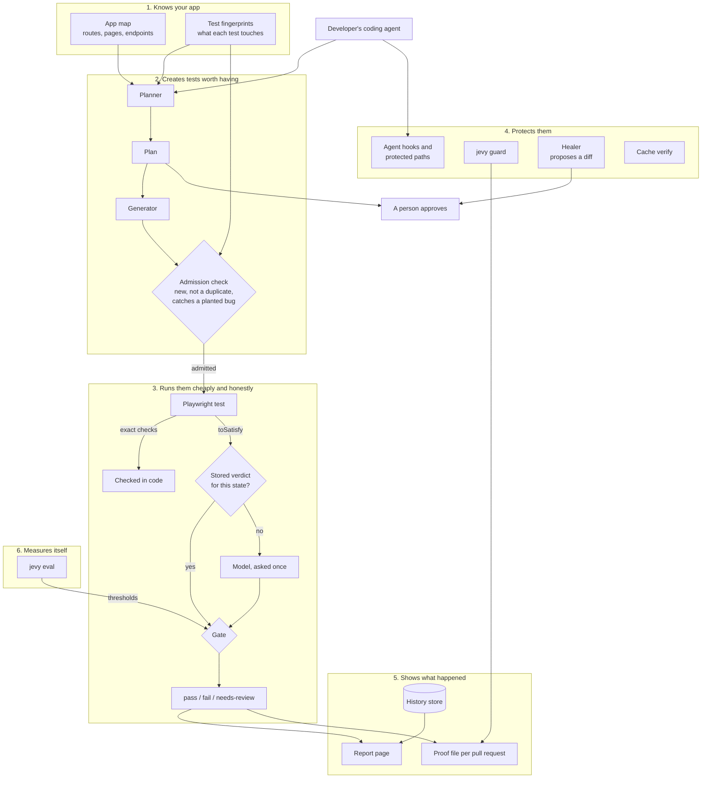

# Jevy — Design

Status: sections 5, 6 and 7 describe code that is in the tree and tested. Section 8 describes what is planned; its TypeScript is a sketch and will change. The order of work is in [ROADMAP.md](ROADMAP.md), and what is undecided is in [OPEN-QUESTIONS.md](OPEN-QUESTIONS.md). Facts about third-party tools come from the project research notes (`RESEARCH.md` and `QA-APPROACHES.md`, 27 Oct 2026), except the comparison in section 12, which follows those projects' public docs and packages as reviewed in November 2026. Anything marked *(estimate)* is a guess.

## 1. What Jevy is for

Coding agents now write much of the code and many of the tests. A written test is no longer the scarce thing. A result you can trust is. Jevy is a test framework for teams whose code and tests are mostly written by coding agents. It runs on Playwright and does six jobs:

1. **Knows your app.** An app map of routes, pages and endpoints, and a fingerprint of what each test touches (planned, §8.3).
2. **Creates tests worth having.** A planner and a generator, and an admission check every new test must pass (planned, §8.4 and §8.5).
3. **Runs them cheaply and honestly.** Exact checks in code; judgement checks answered by a model once, stored in git, and replayed with no model call; three verdicts (the decision layer is built, §5 and §6; the `toSatisfy` matcher is planned, §8.2).
4. **Protects them.** The guard, agent hooks and protected paths (built, §7), a healer that only proposes (§8.5), and checks on stored verdicts and approvals (§8.8).
5. **Shows what happened.** A report page, test history and a proof file per pull request (planned, §8.6 and §8.7).
6. **Measures itself.** `eval` scores a model on labelled cases before its answers are trusted (planned, §8.9).

Web3 is built on the same six jobs (§8.10). Section 3 shows how the jobs connect.

The framework is designed around six properties:

1. **Agent-operable.** An agent can install, run and read Jevy without a person: non-interactive commands, stable exit codes, a versioned machine-readable report, and a reason on every result that is not a pass.
2. **Tamper-evident.** The agent that writes the code also edits the tests. Jevy flags a weakened test, checks that a new cached verdict really came from a model, and does not let an agent approve its own `needs-review`.
3. **Cheap and repeatable in the loop.** A verdict is cached in git and replayed with no model call. A relevant change is a miss, not a guess.
4. **Honest about doubt.** Three verdicts. A weak or cut-off answer is `needs-review`, never a guessed pass or fail.
5. **Measured.** `eval` reports how often each decider is right on labelled cases before anyone trusts it.
6. **Earned and inspectable.** A test joins the suite only if it covers something real and new, and a person can see what every test does and how it has behaved.

Principles that follow:

- **The developer's agent drives.** Jevy runs no model loop of its own. Its planner, generator and healer are definitions and tools that run inside whatever coding agent the developer uses.
- **A test has to earn its place.** A new test must trace to a plan a person approved, add coverage or catch a planted bug nothing else catches, and not duplicate an existing test.
- **It runs inside the existing runner.** Playwright is the first one. Jevy plugs into `@playwright/test` and does not add a runner or a test file format.
- **Plain code first.** Locators and exact assertions run as written. A decider is asked only at defined decision points: judging a semantic check, choosing among candidates the code built, classifying a wallet prompt, and later ranking properties.
- **Nothing is weakened silently.** A broken test is never healed quietly. A fix is proposed as a diff, a person approves it, and the guard reports a weakened test.
- **Decisions are cached and re-checked.** A record is bound to the redacted state, the decider and the model, and passes the gate again on every replay.
- **Numbers in code.** Amounts, balances, dates, gas and chain state are checked with code, never judged by a model.
- **Any model.** One `Decider` interface. The generic LLM adapter comes first and is where the docs start, because everyone can run it. Config has no built-in decider: nothing is sent to any model until a project names one. A local model keeps page content on the machine.
- **Web3 is first class.** A wallet prompt is a state, its classification is a cached decision, the signing policy is code, and the policy file is watched by the guard.
- **Product only.** The repo ships the packages. Users install them and configure Jevy for their own app. Demos are recorded videos, not code in the repo.

## 2. Non-goals

- **No new test runner.** Jevy builds on `@playwright/test`. Other runners may follow; mobile is not planned.
- **No model loop of its own, and no recorder.** Jevy does not call a model to drive the browser toward a goal. Planning, writing and repairing tests are done by the developer's coding agent, using Jevy's agent definitions and tools (§8.5).
- **No quiet healing.** The research found silent heals hide regressions, and Playwright's own healer can loosen assertions or add `test.fixme()`. Jevy's healer proposes a diff and a person approves it.
- **No model judgement of numbers, amounts, balances, dates, gas or chain state.** Jev's own docs say it is weak at maths, counting and date comparison ("keep the arithmetic in code").
- **No natural-language tests at run time.** A statement in `toSatisfy` is an assertion inside a code test. What runs in CI is code plus recorded decisions.
- **No autonomous exploratory testing as a merge gate.** The evidence rates it "promising, not a merge gate": the best of 15 agents found and fixed 59.0% of bugs on SWEeper-Bench. If it comes, it is advisory.
- **No hosted service is required, and there is no vendor test format.** The report page is a static page a project opens locally or publishes itself, and history goes to a store the project chooses. A hosted Jevy dashboard may come later as a separate, optional product (§8.7).
- **No bundled example apps or site-specific code.** Package tests use small fixtures inside each package.
- **Not an AI auditor, and no replacement for human review or audits.**

## 3. How it fits together



The planner, generator and healer run inside the developer's coding agent. Everything in jobs 3 to 5 that decides whether a merge is allowed runs with no agent and no model.

| Piece | Package | State |
|---|---|---|
| Decider contract, verdict gate | `@jevyjs/core` | Built (§5.1, §5.2) |
| Snapshot validation, hash, pruning | `@jevyjs/core` | Built (§5.3) |
| Redaction | `@jevyjs/core` | Built (§5.4) |
| Decision cache and replay | `@jevyjs/core` | Built (§5.5) |
| Config loader | `@jevyjs/core` | Built (§5.6) |
| Page snapshot from Playwright | `@jevyjs/playwright` | Built (§6) |
| Guard, protected paths, hooks, skill file | `@jevyjs/cli` | Built (§7) |
| Deciders: LLM, Kev, Jev | `@jevyjs/deciders-*` | Planned (§8.1) |
| `toSatisfy` and `report.json` | `@jevyjs/playwright` | Planned (§8.2) |
| App map and test fingerprints | `@jevyjs/cli`, `@jevyjs/playwright` | Planned (§8.3) |
| Admission check and mutation gate | `@jevyjs/cli` | Planned (§8.4) |
| Planner, generator, healer, `init` | `@jevyjs/cli` | Planned (§8.5) |
| Report page and proof bundle | `@jevyjs/cli`, `@jevyjs/playwright` | Planned (§8.6) |
| Test history and its store interface | `@jevyjs/core`, `@jevyjs/cli` | Planned (§8.7) |
| Cache verification and approvals | `@jevyjs/cli` | Planned (§8.8) |
| Eval | `@jevyjs/cli` | Planned (§8.9) |
| Wallet pack | `@jevyjs/web3` | Planned (§8.10) |
| Properties and invariants | to be decided | Planned (§8.11) |

## 4. Packages

```
packages/
  core/            @jevyjs/core           decider contract, verdicts, snapshot hash, redaction, pruning, cache, config
  playwright/      @jevyjs/playwright     page snapshots; later toSatisfy, test fingerprints and the report page
  cli/             @jevyjs/cli (bin jevy) guard and hooks; later the app map, admission, the agents, cache, eval and init
  deciders-llm/    @jevyjs/deciders-llm   generic adapter for any LLM (stub)
  deciders-kev/    @jevyjs/deciders-kev   Kev adapter, local (stub)
  deciders-jev/    @jevyjs/deciders-jev   TypeSafe AI Jev adapter, hosted (stub)
  web3/            @jevyjs/web3           wallet pack (stub)
docs/              design, roadmap, open questions, spikes
```

**Naming.** Every package publishes under the `@jevyjs/*` scope. The CLI is `@jevyjs/cli` and installs a `jevy` command. (`@jevy` belongs to an unrelated npm user, and npm blocks the unscoped `jevy` as too similar to `jest` and `levn`; see OPEN-QUESTIONS.) The source lives at github.com/AdamGencel/jevy. Code is MIT.

**Dependency rules.**
- `core` has no model SDK and makes no network calls.
- No hard dependency on any LLM provider. `deciders-llm` takes a user-supplied adapter.
- Each decider is a separate package, so users install only what they use.
- `playwright` depends on `core`, with `@playwright/test` as a peer dependency. `web3` will depend on `core`, with viem as a peer.
- `cli` does not depend on `core`. The guard parses files; it never imports or runs code from the repo it checks.

**Test fixtures** (small static pages, and later a tiny dApp page for the wallet pack) live inside each package's tests and are not published as examples.

## 5. Built: the decision layer (`@jevyjs/core`)

### 5.1 The decider contract

A decider answers named, typed questions about one state. The three question kinds cover every decision point, and any LLM can emulate them with structured output.

```ts
type Question =
  | { kind: "yesno"; prompt: string; criteria?: string }
  | { kind: "choice"; prompt: string; options: { id: string; label: string }[] } // 1 to 255 options
  | { kind: "score"; prompt: string; levels: string[] };                          // 2 to 10 levels, worst to best

interface Answer { value: string; confidence: number; abstained?: boolean; raw?: unknown }

interface DecisionState { snapshot: AccessibilityNode; url?: string; goal?: string; wallet?: WalletContext }

interface Decider {
  readonly id: string;     // "llm:<provider>/<model>", "kev", "jev"
  readonly model: string;  // a pinned model id
  decide(state: DecisionState, questions: Record<string, Question>): Promise<Record<string, Answer>>;
}
```

- **`callDecider` is the only supported way to call a decider.** It redacts and prunes the state, redacts the questions, calls `decide`, and checks the answers. It returns `{ answers, truncated }`.
- **There is no screenshot field.** `prepareDecisionState` throws if a `screenshot` property is present.
- **Limits are part of the contract.** More than 255 options, or a score outside 2 to 10 levels, throws. Core does not drop options to fit. The 255 cap is Jev's choice limit; every adapter must accept the same questions.
- **`confidence` is one number today,** and it is not trusted until `eval` has calibrated it (§8.9).

**The question is redacted too.** `callDecider` redacts each prompt, yes/no criteria and choice label with the same rules as the snapshot before the decider sees them: a prompt is written by a person or an agent and can quote an email or a key as easily as a page can. Option ids and score levels are the values a decider answers with, so they are sent as written. One that redaction would change is refused with `RedactionError` before any call. Answers are checked against the questions as the caller wrote them.

**Abstention.** An `Answer` may set `abstained: true` when the decider cannot decide from the state it was given. The answer must still have a non-empty string `value` (free text such as a reason) and a `confidence` in [0, 1]. The value is not checked against the yes/no values, option ids or levels. An abstained answer always gates to `needs-review`, whatever its confidence, and `probabilityOfYes` refuses it with a `QuestionError`. An `abstained` field that is present but not a boolean is a `QuestionError`. A decider should abstain rather than guess, because a guessed "no" would be an unearned `fail`.

**Answer keys are own properties.** `assertAnswers` checks own properties only (`Object.hasOwn`), in both directions. Without this, an extra answer named `constructor`, `toString` or `__proto__` would be accepted, and a missing answer for a question with such a name would be found on `Object.prototype`.

### 5.2 Verdicts and the gate

```ts
type Verdict = "pass" | "fail" | "needs-review";
interface Thresholds { pass: number; fail: number } // defaults 0.8 and 0.5, placeholders until eval
```

`gateAnswer(question, answer, thresholds, { truncated })` maps one answer to a verdict.

Yes/no confidence is how sure the decider is of the value it returned. The gate does not convert that into P(the statement holds), and it does not flip a weak answer into the opposite verdict.

- A `yes` is `pass` only when confidence >= `pass`. With the defaults, `yes` at 0.8 or 0.93 passes. `yes` at 0.79 or 0.25 is `needs-review`.
- A `no` is `fail` only when confidence >= `pass`. That is a confident no. With the defaults, `no` at 0.8 or 0.93 fails. `no` at 0.79 or 0.125 is `needs-review`.
- Anything below `pass` is `needs-review`, whether the value is `yes` or `no`, and whether confidence sits between `fail` and `pass` or below `fail`.

The `fail` threshold does not change a yes/no verdict. Using it as a cut on P(yes) was the rule that flipped a `no` at 0.125 into `pass` (because `1 - 0.125 = 0.875`) and that failed a weak `yes`. Both are rejected: uncertainty is `needs-review`, not evidence for the other answer, and not a product failure. Projects may still set `fail`. Two different `fail` values with the same `pass` produce the same yes/no verdict. `fail` must remain strictly below `pass` because score verdicts use the band between them.

Score levels are ordered from worst to best. The chosen level is a position from 0 to 1, then moved toward 0.5 by `(1 - confidence)`. The adjusted position is `pass` when it is >= `pass`, `fail` when it is < `fail`, and `needs-review` in between. That is a point on an ordered scale. It is not the yes/no rule, and it does not invert a boolean answer.

A choice must name one of the option ids. Confidence at or above `pass` accepts it (`pass`); anything lower is `needs-review`. A choice is never `fail`. The `fail` threshold does not apply. More than 255 options, or a score outside 2 to 10 levels, throws. Core does not drop options to fit the cap.

**Truncation reaches the verdict.** `callDecider` returns a `DecisionResult` of `{ answers, truncated }`. `truncated` is what pruning reported for the snapshot the decider actually saw. Pass it on as `gateAnswer(question, answer, thresholds, { truncated })`. When `truncated` is `true`, a verdict that would be `fail` becomes `needs-review`, for yes/no and for score. `pass` and `needs-review` do not change, and a choice is never `fail` in any case. The reason for the asymmetry: a "no" about a pruned page may only mean the evidence was pruned away, while a "yes" means the evidence was seen. A `truncated` value that is not a boolean throws `QuestionError`.

### 5.3 Snapshots: validation, hash and pruning

The state a decider sees, and the state a verdict is bound to, is an `AccessibilityNode` tree: `role`, `name`, `value`, states and `children`. It is core's own format. Core does not depend on Playwright; §6 says how a Playwright page becomes one.

**Validation.** Before any text is read, `redactSnapshot` and `normaliseSnapshot` (and so `hashSnapshot`, `prepareDecisionState` and `callDecider`) run `validateSnapshot`. A node that is null, an array or a primitive throws `SnapshotError`, and so does: a role that is not a non-empty string; `children` that is not an array; a `value` that is not a string or a finite number; or a name, description, valuetext, roledescription, keyshortcuts, invalid, autocomplete, haspopup or orientation that is not a string. The message names the problem and the node's path, such as `children[2].children[0]`. A node object used in two places is two nodes and hashes like a copy. Only a node that is its own ancestor is a cycle. A tree deeper than `MAX_SNAPSHOT_DEPTH` (512 levels below the root) is rejected, so a runaway tree fails with a clear error instead of overflowing the stack. A tree with more than `MAX_SNAPSHOT_NODES` (250,000) nodes, counting a reused node once for each place it appears, is rejected too: a few dozen objects that each hold the next one twice would otherwise expand without end.

**What the hash covers.** `hashSnapshot` returns `sha256:` and 64 hex characters. The payload is canonical JSON `{ v, rules, tree }` of the redacted, normalised tree, or of one region of it. Pruning does not affect the hash: a node removed only to fit a token budget still changes the hash when the page changes. The URL is not part of the snapshot hash.

The same hash:

- Key order, collapsed whitespace, and `children: []` versus no children.
- `focused`, and fields outside the allow-list (`autocomplete`, `orientation`, `multiline`, `haspopup`, `keyshortcuts`, and the other presentational flags).
- Inner `none` and `presentation` nodes, and unnamed `generic` nodes. Their children are promoted. The root node is kept.
- Timestamps that include a time (`2026-10-28T01:02:03Z`), relative times (`3 seconds ago`), UUIDs, and runs of 8 or more digits.

A new hash:

- Accessible name, role, added or removed nodes.
- `checked`, `pressed`, `expanded`, `selected`, `disabled`, `required`, `readonly`, `modal`, heading `level`, and a numeric `value`.
- A bare calendar date (`Due 2026-10-28`). Dates without a time are treated as content.
- A short number (`Order 42`). Long digit runs are the volatile ones.

A region is `{ role, name? }`, matched on the normalised tree, first hit in tree order. The caller's name is normalised the same way. A miss throws, instead of hashing the whole page.

`normalise.disable` can turn off `uuid`, `timestamp`, `relative-time`, or `long-digits`. Extra `replace` patterns and `dropRoles` are added. `none` and `presentation` always drop.

**The hash carries a rules version.** The hashed digest is the canonical JSON `{ v: SNAPSHOT_HASH_VERSION, rules: SNAPSHOT_RULES_VERSION, tree }`, with `SNAPSHOT_HASH_VERSION = 2` and `SNAPSHOT_RULES_VERSION = 2`. Rules version 1 was the built-in rule set before the November 2026 seed-phrase and key-pattern changes. A change to a built-in redaction or normalisation rule can change the hashed tree without any change to the hashing code, so the built-in rules carry their own version. `golden-hash.test.ts` pins eight snapshots to literal hashes: a plain page, an email address, a password textbox, a seed phrase split one word per node, a 0x private key, volatile text, an unwrapped generic node, and a region slice.

**Rules fingerprint.** `rulesFingerprint({ redact, normalise })` returns `sha256:` plus 64 hex characters over canonical JSON of four things: the hash version, the rules version, the project's redact rules in order, and the resolved normalise options. In that JSON:
- a RegExp is written as `{ source, flags }`, with `g`, `y` and `d` dropped because matching ignores them, and the other flags sorted;
- a role rule is written as its role, its name (a string or a serialised RegExp) and its replacement;
- `disable` and `dropRoles` are sorted, and `replace` keeps its order.

`region` is not included. Equal rules give an equal fingerprint, and any rule change that could change a snapshot hash gives a different one. The decision cache stores the fingerprint so that a miss can say "your redaction or normalisation rules changed" instead of "the page changed".

**Pruning.** The token estimate is `ceil(canonicalJson.length / 4)`. It is not a model tokenizer. Default prune limits are 400 nodes, depth 16, and 12,000 tokens. Kev uses 6,000 tokens so a question still fits in the 8,192-token window. `maxNodes` must be an integer of at least 1, `maxDepth` an integer of at least 0, and `maxTokens` a finite number above 0; anything else throws `SnapshotError`. Depth is cut first, for every node. Then nodes are removed in a fixed order. A node is protected when its role is in `keepRoles`, when it sits inside such a node, or when it contains one. The default `keepRoles` is `DEFAULT_KEEP_ROLES`: alert, alertdialog, dialog, status and heading, because an error banner, a dialog or a heading is what a question is most often about. Every unprotected node goes before any protected one. Within each group the deepest node goes first, and ties go to the one latest in document order, so earlier content survives. `keepRoles` replaces the default, and `keepRoles: []` gives the plain deepest-first order. The root stays. An unprotected node never has a protected descendant, so a node always comes after its descendants. That means the removal order is fixed up front and the number of removals is found by binary search, so pruning is O(n log n). If the bare root is still over budget, its name, description, valuetext, string value and roledescription are shortened in that order. Each is dropped entirely before the next is touched, and a surrogate pair is never split. If even the bare root does not fit, `SnapshotError` is thrown. A pruned result is never over its node or token budget. `truncated` is reported and is not hashed. `callDecider` sets the budget from `decider.id`, so a Kev decider always gets the Kev budget.

### 5.4 Redaction

Redaction runs inside `hashSnapshot`, `prepareDecisionState`, and `callDecider`. Built-in rules always run. `redact` in config adds rules. If a second pass still matches a secret pattern, `RedactionError` is thrown and nothing is returned.

Built-ins remove PEM private keys, AWS access keys, GitHub tokens, Slack tokens, Stripe-style keys, `sk-` keys, Google `AIza` API keys, JWTs, bearer tokens, `api_key=` / `password=` assignments, email addresses, and common phone numbers. A seed phrase is a run of 12 or more words from the BIP-39 English wordlist, which is vendored for that check only. The words may be separated by whitespace, list numbers (`1.`, `2)`) or punctuation such as commas, and the whole run is redacted, including any BIP-39 word next to it (a heading ending in "Phrase" loses that word). The checksum is not checked, so a run of ordinary BIP-39 words is redacted too; that is the safe direction to be wrong in. A phrase shown one word per node, as wallet grids do, is found by reading the text fields of the tree in document order. Each word is replaced in its own node and list numbers are kept. After normalisation the tree is checked again, and a phrase that survives throws `RedactionError`.

64 hex characters, with or without a `0x` prefix, are treated as a private key and redacted (wallets often export keys without `0x`). A 40-hex address is not: addresses are public and are often the thing under test. A transaction hash, or any SHA-256 hex digest, has the same shape as a private key, so it is redacted too. That is the tradeoff to confirm.

A textbox or searchbox whose name or autocomplete says password, passphrase, secret, API key, mnemonic, seed phrase, recovery phrase, or private key (with or without a space, hyphen or underscore, so `privateKey` counts) has its value replaced. The accessible name stays, so the hash still shows that the control exists. The replacement token is `[REDACTED]`, so two secrets in the same place hash the same. Wallet field names are split into words (`privateKey` becomes private, key). A field is replaced entirely when one word is secret, seed, mnemonic, password, passphrase, passcode, privkey or apikey, or two adjacent words are private key, API key, access/auth/refresh/session/bearer token, or recovery phrase. Plain `token`, `key` and `publicKey` are kept: on an approve prompt the token address is the thing under test. Every value still passes through the text patterns, so a raw key in a field such as `pk` is caught there.

### 5.5 Decision cache

A test asks a decider a question about a page. The answer is stored in git. Later runs, CI above all, replay the stored answer with no model call. A stored answer is reused only for the same question, the same state, the same decider and the same model.

**Location and store.** By default `.jevy/decisions/`, committed to git. One JSON Lines file per spec at `<dir>/<spec>.jsonl` (for example `.jevy/decisions/tests/checkout.spec.ts.jsonl`). A spec path must be relative and use forward slashes, with no empty, `.` or `..` segment and no NUL; anything else is a `CacheError`. The store interface is `DecisionStore { latest(key), forStep(spec, step), append(records), list(spec?) }`. Core ships `JsonlDecisionStore({ dir })` and `MemoryDecisionStore` (for tests). The JSONL store reads every `.jsonl` file under `dir` once, on first use, and keeps an in-memory index. That suits one test run with a single writer per directory; open a new store to see files another process wrote. A malformed line is a `CacheError` naming `<file>:<line>`.

**Key.** `decisionKey` is `sha256:` plus hex over canonical JSON with the key order `{ v: 1, kind, question, options, snapshotHash, decider, model }`.
- `question` is `questionText(question, redact)`: the prompt redacted and whitespace-collapsed, plus `\nCriteria: <criteria>` for a yes/no question with criteria.
- `options` are the `{ id, label }` pairs sorted by id for a choice (a changed label changes the key), the levels in order for a score, and `[]` for yes/no.
- `snapshotHash` is `hashSnapshot` of the redacted, normalised tree, or of the step's region. When a region is given, the decider is also shown only that region.
- `DECISION_KEY_VERSION` is 1.

**Record (one line, keys always in this order):**
```json
{"v":1,"key":"sha256:…","spec":"tests/checkout.spec.ts","step":"toSatisfy#2","kind":"yesno","question":"The page shows the order as confirmed","snapshotHash":"sha256:…","decider":"jev","model":"jev-1.14.0","answer":"yes","confidence":0.93,"abstained":false,"truncated":false,"verdict":"pass","thresholds":{"pass":0.8,"fail":0.5},"rules":"sha256:…","createdAt":"2026-10-27T22:00:00.000Z","reviewedBy":null,"reviewVerdict":null}
```
- `truncated`: the decider saw a cut-off snapshot.
- `abstained`: the decider declined to answer.
- `rules`: `rulesFingerprint` of the redact and normalise rules at write time.
- `verdict` and `thresholds`: what applied at write time.
- `createdAt`: ISO 8601 UTC.
- `reviewedBy` and `reviewVerdict` (`"pass"` or `"fail"`) are both null or both set.

`parseRecord` rejects any unknown field, a wrong `v`, or any malformed value with `CacheError`. A record never contains a snapshot or page text other than the question. Spec, step, question and answer go through `redactText` before anything is written, and a redaction failure writes nothing. An answer that redaction would change (other than an abstention's free text) is refused, because it could never be replayed.

**Modes and hits.** `createDecisionSession({ store, mode, deciderId, model, decider?, thresholds, snapshot?, now?, memo? })` and `session.decide({ spec, step, question, state, region? })` return `{ verdict, source, key, snapshotHash, truncated, answer?, reason?, record? }`.
- A hit with a human review returns `reviewVerdict` with source `review`, and is not gated.
- Any other hit is re-gated with the current thresholds and the record's `truncated` flag (source `cache`). If the result differs from the stored verdict, the reason is `regated-below-threshold`.
- `replay` never calls the decider; a miss is `needs-review` with source `none`.
- `replay-or-query` calls the decider on a miss.
- `record` always calls it.

**Miss reasons.** Look at the step's records with the same question text. If there are none, the reason is `no-entry`. Otherwise compare with the most recent one: different `rules` gives `redaction-changed`; a different decider or model gives `model-changed`; anything else gives `snapshot-changed`.

**Writes held until the test confirms.** Records from decider calls are held by the session. `confirm()` appends them (call it when the test passes), and `discard()` drops them (call it when it fails). A held record is not a hit.

**Run memo.** `createRunMemo()` maps a key to the answer and truncation drawn in this process. Pass one memo to all sessions of a run: when the memo has the key, `decide` does not call the decider again, in any mode, and does not hold a second record. A Playwright retry therefore cannot draw a new answer.

**Review semantics.** A human decision is recorded by appending a copy of the record with `reviewedBy` and `reviewVerdict` set. The last appended record for a key wins. Who may set `reviewedBy` is not restricted yet. `jevy guard` flags every approval added in a diff (§7), and roadmap step 10 makes approvals checkable (§8.8).

**Other storage.** `cache.store` in config is rejected. A project that wants its records somewhere else implements `DecisionStore`.

**Still open.** Two specs that ask the same question about the same state share a key, and so share a record, including a human review. A retry that passes on an answer remembered from a failed first attempt writes no record, so the next run asks again. Both are to be settled with the Playwright matcher (§8.2).

#### Why a cached verdict is not the recording checking itself

e2e caches verified action paths and runs assertions live. The objection to caching an assertion verdict is that replay would be "verifying the recording with the recording": the stored answer would pass the test because it is the stored answer. Midscene also leaves `aiAssert`, `aiQuery` and `aiBoolean` uncached. Jevy does cache verdicts. The rules below are what keep a replay from being the recording checking itself.

- **Bound to a redacted state hash and to the decider and model.** The key covers the question kind and text, the options, the snapshot hash, the decider id and the model. The snapshot hash is of the redacted, normalised tree (or one region of it), not of the verdict. The record does not store the raw page.
- **Invalidated by a relevant state change.** A change to an accessible name, role, value or the nodes the hash covers is a different key. The old verdict is not a hit. Normalisation still drops cosmetic changes (timestamps, UUIDs, long digit runs) so those do not force a new call. See §5.3.
- **Re-gated on replay.** A hit passes the stored answer through the confidence gate again, using the project's current thresholds. Replay can return `needs-review` when the recorded answer was `pass` or `fail`. An abstention stays `needs-review`.
- **Refreshable.** `replay` never calls a model: a miss is `needs-review`. `replay-or-query` and `record` append a new record from a new decider call. A scheduled refresh is how a stale verdict gets a new answer. CI in `replay` mode does not call the model to bless the stored one.

Inside one run, the run memo gives a retry the answer the first attempt drew. A retry cannot draw a new answer until the state, the decider or the model actually changes.

### 5.6 Config

`defineConfig` only types the object. `loadConfig` executes `jevy.config.ts`, then `.mts`, `.js`, or `.mjs`, using Node's type stripping (on by default from Node 22.18, which is the minimum), and `parseConfig` checks the result. Unknown keys throw. A missing file throws. Config has no built-in decider: nothing is sent to any model until the project names one or a test passes an override. `decider: "kev"` is the one-line local switch. `selectDecider(config, "kev")` is the per-test override this package can apply. The planned per-test switch in Playwright (`test.use`, §8.2) will call the same function. An override to the decider the project already selects keeps the project's model pin; an override to a different decider uses that decider's own configured model. An override never reuses the fallback list. Fallback ids are checked and stored. Nothing calls them.

When Jev is selected and unconfigured, the pin is `jev-1.14.0`, the base URL is `https://api.typesafe.ai`, and the key is read later from `TYPESAFE_API_KEY`. The loader stores that name and does not read the value. Kev defaults to `kev-4b@v1.0` at `http://127.0.0.1:8009`. An LLM decider requires `deciders.llm.adapter.complete` and an explicit `model`.

`jev-latest` and `jev-preview`, including a `~typesafe/` or other author prefix, are rejected unless `deciders.jev.allowMovingAlias` is true. A Jev base URL must be https and one of `https://api.typesafe.ai`, `https://openrouter.ai/api`, or `https://ai-gateway.vercel.sh/typesafe`. Kev accepts any http(s) URL without credentials. Config rejects a look-alike host before an adapter exists.

`cache.dir` defaults to `.jevy/decisions`. `cache.mode` is `replay` when `CI` is set and is not `""`, `"0"`, or `"false"`; otherwise `record`. `cache.store` is rejected; a project that wants its records somewhere else implements `DecisionStore` (§5.5). `ci.needsReview` defaults to warn on pull requests and fail on `main`.

`protect`, `checks` and `guard.tests` are lists of strings for the guard and the hooks (§7). The loader checks their shape, and refuses a glob the guard's matcher could not honour, and an empty `guard.tests`, which would compare no file at all. The guard and the hooks do not use the loader: they read the same keys from the file's text, because loading a config means running it.

`web3` is optional. When present, `driver` defaults to `"mock"` and `allowMainnetSigning` defaults to false. A known mainnet chain id adds a warning. The wallet pack does not exist yet; the warning records the intended refusal. `privateKeyEnv` and `rpcUrlEnv` must be variable names. A pasted key fails validation. `snapshotOptionsFromConfig` passes the loaded redact rules and normalisation into the hash.

`parseConfig` rejects rules that could never settle. Redaction fails closed when a second pass still changes the text, so these would otherwise fail every snapshot at run time:
- A `redact` pattern (bare RegExp or `{ pattern }`) that can match an empty string. This includes zero-length matches such as `\b` or a lookahead, found by probing a sample text.
- A rule set under which `[REDACTED]`, or any rule's `replacement`, would be redacted again, for example `/RED/`. The error names the rule, or the built-in pattern, and whose replacement it matched.
- A `normalise.replace` pattern that can match an empty string, or that matches its own placeholder.
These checks build a fresh expression without the `g`, `y` and `d` flags, so a rule's `lastIndex` neither affects the check nor is changed by it. `findRedactionConflict(rules)` is exported for tools that build rule sets themselves.

A config that loads today:

```ts
// jevy.config.ts
import { defineConfig } from "@jevyjs/core";

export default defineConfig({
  decider: { use: "llm", fallback: ["kev"] },      // shorthand: decider: "llm"
  deciders: {
    llm: { adapter: myLlmAdapter, model: "provider/model-id" },
    kev: { baseUrl: "http://127.0.0.1:8009", model: "kev-4b@v1.0" },
    jev: { apiKeyEnv: "TYPESAFE_API_KEY" },        // pinned to jev-1.14.0 unless a model is given
  },
  thresholds: { pass: 0.8, fail: 0.5 },            // replace with eval output
  cache: { dir: ".jevy/decisions" },               // mode: replay when CI is set, record otherwise
  ci: { needsReview: { pr: "warn", main: "fail" }, mainBranch: "main" },
  redact: [/ORDER-\d+/, { role: "textbox", name: /backup code/i }],
  web3: {
    driver: "mock",
    chain: { id: 11155111, rpcUrlEnv: "SEPOLIA_RPC_URL" }, // or { fork: { rpcUrlEnv: "FORK_SOURCE_RPC_URL" } }
    account: { privateKeyEnv: "JEVY_TEST_PRIVATE_KEY" },
    policy: "./wallet-policy.ts",
    allowMainnetSigning: false,
  },
  protect: ["docs/test-plan.md", "tests/payments/**"], // an agent must not change these without a person
  checks: ["pnpm lint", "pnpm typecheck", "pnpm test"], // what `jevy hook stop` runs
  guard: { tests: ["e2e/**/*.ts", "**/*.spec.ts"] },     // files `jevy guard` compares as tests
});
```

## 6. Built: the snapshot bridge (`@jevyjs/playwright`)

Current Playwright has no `page.accessibility`. What it offers is `locator.ariaSnapshot()`, which returns YAML. `parseAriaSnapshot(yaml)` turns that into core's tree, and `snapshotAccessibility(pageOrLocator)` is the supported way to take a snapshot. The evidence behind this section is in [spikes/snapshot-source.md](spikes/snapshot-source.md).

- **What the source fills:** role, name, value (inputs and textareas only), checked, pressed, disabled, expanded and selected (true only), level and invalid.
- **What it never fills:** description, required, readonly, modal, multiline, multiselectable, orientation, keyshortcuts, roledescription, haspopup, autocomplete, valuetext, valuemin and valuemax. A hash of a Playwright page cannot see a change to those.
- **What is dropped:** link URLs and placeholders, which core has no field for. A link that points somewhere new does not change the hash. Adding a redacted `url` field is carried into roadmap step 3.
- **Secret fields.** The aria snapshot prints password and other secret field values in clear, and drops `type` and `autocomplete`, so core's autocomplete rule cannot fire for a Playwright page. `snapshotAccessibility` reads password inputs and inputs with a secret autocomplete token (`SECRET_AUTOCOMPLETE_TOKENS`, exported by core) from the DOM in the same step, and replaces their values with `[REDACTED]` wherever they appear in the tree, whatever the label says. If the values keep changing between the two reads, it throws instead of returning.
- **Known gap.** A password field that a "show password" control has switched to `type="text"`, and that has no secret autocomplete token, is not recognised.
- **An attribute the parser does not know throws.** If a future Playwright prints a new state, snapshots fail loudly instead of hashing something unexpected.
- **Peer range** is `@playwright/test >= 1.49.0`, the first version with `ariaSnapshot()`. Only 1.63.0 has been run.

## 7. Built: the guard, protected paths and agent hooks (`@jevyjs/cli`)

A coding agent that writes the code also edits the tests, and the quickest way to turn a failing test green is to weaken it. `jevy guard` reports every change that could weaken a repo's checks; the hooks run it, and the project's own checks, inside the agent's session. Usage, the finding kinds, exit codes, the JSON shape and the known limits are in the README.

### 7.1 The guard

`jevy guard --base <ref>` is a pure, model-free diff. A `RepoReader` lists the changed files and reads both versions. The git implementation uses `execFile` with argument arrays, `git diff --name-status -M -z` and `git cat-file blob`, plus untracked files when the head is the working tree. Each file goes to one of four comparisons by path:
- test files (`**/*.{spec,test}.{ts,tsx,mts,cts,js,jsx,mjs,cjs}` outside node_modules and dist, or the globs from `--tests` or `guard.tests`)
- `jevy.config.*`
- `playwright.config.*`
- `*.jsonl` under the cache directory

Sources are parsed with `ts.createSourceFile` and never executed. A file with a syntax error is reported for review instead of being compared, because a recovered tree could invent or hide changes. Tests are identified by their describe-plus-title path. The skip/only/fail markers on a test include those of every enclosing describe and of the file. Assertions are compared as multisets of matcher names and of 'signatures' (subject and arguments kept only when they are literals), so formatting, reordering and variable renames are not reported as changes. Decision files are diffed as multisets of lines because records are append-only. A newly added line with a non-null `reviewedBy` is weakening until roadmap step 10 makes approvals checkable (§8.8). Findings are sorted by file, line and kind, and the JSON report is versioned (`v: 1`).

**Which commit is the base.** With `--merge-base` the guard compares against `git merge-base <base> <head>`, so tests added to the target branch after a pull request branched are not mistaken for tests it removed. The report keeps `base` as given and adds `mergeBase`. A ref that names both a tag and a branch pointing at different commits is refused, because git would silently pick one.

**The working tree.** With no `--head`, the guard compares the base with the working tree and also with the index, and merges the findings. A weakened test that is staged and then restored on disk would otherwise pass and still be committed. It refuses to run (exit 2) when git is told not to look at a file (`skip-worktree`, `assume-unchanged`), when a path it must read is not a regular file, and when the run directory is spelled differently on disk and in git.

**Settings come from the config's text, and from its base version.** The guard reads `cache.dir`, `guard.tests`, `protect` and `web3.policy` from `jevy.config.*` in the directory it runs in, with the TypeScript parser (`config-source.ts`). It reads the version at the base commit when the file exists there, so the change under review cannot move the cache directory, narrow the test globs or shrink the protect list and benefit in the same run. A config that exists only in the head version can widen what is checked, never narrow it, and a config that git ignores stops the guard. The reader returns a value only for a shape it can prove: one default export, an object literal or `defineConfig(...)` of one, with no later write to it. Anything else is "unreadable", and an unreadable setting the guard needs is exit 2, not a guess.

### 7.2 Protected paths

A protected path is a file an agent must not change without a person. Three are built in: every `jevy.config.{ts,mts,js,mjs}`, the decision cache directory, and the file named by `web3.policy`. A project adds its own with `protect: string[]`, globs relative to the config file: test plans, and any tests it chooses. Read-only tests are the measured middle ground against test gaming; hiding tests entirely also hurts honest work.

- The guard reports `protected-path-changed` (weakening) for every added, changed, deleted or renamed file that matches, and for a change to the `protect` list itself.
- Decision record files (`*.jsonl` under the cache directory) are the exception in the guard. A test run writes them, and §7.1 already compares them record by record, so reporting each new record as weakening would fail every change that adds a model-judged check. The pre-edit hook still blocks an agent that edits one by hand.
- Matching folds case and Unicode form on both sides, because macOS and Windows disks treat `Tests/` and `tests/` as one directory. On a case-sensitive disk this protects slightly more than was listed, which is the safe direction.
- The glob matcher (`glob.ts`) is small and has no dependency: `*`, `**`, `?` and `{a,b}`, anchored at the config's directory, and a glob that matches a directory covers everything beneath it. Anything it cannot honour (negation, character classes, extglob, a `..` segment) is refused when the config loads and when the guard runs, by the same rule written twice, since `cli` and `core` do not import each other. A glob that silently matched nothing would leave a path unprotected with no sign of it.

### 7.3 Weak new tests

The guard used to see only an existing test being weakened. For a test that is new, or whose body changed, it now reports at most one of:

- `test-without-assertion` (weakening): the body has no `expect` chain and no `toSatisfy`, and reads nothing the guard cannot follow.
- `assertion-not-visible` (review): there is no visible assertion, but the body uses something defined in another file (an imported helper, a page object, a custom fixture), throws, or sits under a hook that does. The assertion may be there.
- `assertion-cannot-fail` (weakening): every assertion has an outcome that does not depend on the code under test: a literal against literals under a built-in matcher (`expect(true).toBe(true)`), or an expression compared with itself (`expect(total).toEqual(total)`).
- `only-checks-mocks` (review, best effort): every asserted value is a mock the test created and only called itself.

The rule behind the details is that a weakening finding must be right, because it blocks an agent's session. Where the guard cannot be sure, it reports review or nothing: one real assertion among weak ones is silent; a constant assertion that must fail (`expect(true).toBe(false)` after a `catch`) is a reached-marker, not a weak check; a custom matcher on a literal is the code under test; built-in fixtures are trusted only when `test` comes from the framework. A helper in the same file is read, and counts only when it is called and asserts something real. Formatter-only edits do not make a test "changed". A parameterised test, or one with a non-literal title, gets the no-assertion rule only, since rows can make a constant-looking assertion real.

### 7.4 Agent hooks

A hook is deterministic where an instruction is not. An agent that claims success without running the checks is the most common failure, so the hooks run them. They are commands the agent's own hook system calls; Claude Code is the first. Its contract shapes the design: exit code 2 blocks and hands stderr to the agent as the reason, exit code 0 allows, and any other exit code, a crash or a timeout lets the action through. So every path that means to block ends in exit 2, inside a deadline.

- **`jevy hook stop`** runs before the agent may finish. It runs each command in the config's `checks` list (the project's real lint, type-check and test commands) through a shell, all of them even after one fails, then the guard twice: the branch against the default branch with `--merge-base`, and the session against the commit it started on. The second comparison exists because an agent that commits on the default branch would otherwise leave nothing between the base and `HEAD` to compare. A changed Jevy config is a failure in its own right. On failure it exits 2 with the failed checks, the findings, and a line telling the agent to fix the cause and not to weaken a test to get past it.
- **The loop is capped.** A failure has a signature: the failed commands and the guard's findings, not the output text. After two blocked attempts in a row with the same signature the third lets the agent stop, and the person is told what still fails through Claude Code's `systemMessage`. Six blocks in one run end it whatever the signatures. An agent that cannot fix something should hand back to a person, not spin. The count lives in a small file in the temp directory, never in the repository.
- **`jevy hook pre-edit`** reads the pending edit from stdin, resolves the path through symlinks, and blocks it when it is a protected path (§7.2), with a message telling the agent to ask the maintainer.
- **`jevy hook session-start`** records the commit `HEAD` points at when a session starts. A resume does not move it.
- **`jevy hook print --agent claude`** prints the settings snippet that wires the three. Writing it into the agent's settings is `jevy init` (§8.5).

The hooks read the config as text, as the guard does, and never import it. The check commands are the one thing they run from the repository, and those come from the config, which is a protected path.

**What the hooks are not.** They are not a sandbox. An edit made through a shell command does not pass through the pre-edit hook; the stop hook's guard reports it afterwards. An agent with a shell can remove the hooks from its own settings or delete the state file. The guard in CI, from a clean checkout, compares commits and depends on nothing the agent controls; that is the check that holds. The hooks make weakening a test something an agent cannot do by accident or in passing.

### 7.5 The skill file

`packages/cli/skill/SKILL.md` ships in the package: the exact commands and the rules (never weaken a test; a new test must check something; ask before touching a protected path; a fix is a diff for a person) in 30 lines. A test holds it to 40. Long instruction files raise cost and lower task success.

## 8. Planned

Nothing in this section exists yet. The step numbers refer to ROADMAP.md, which also says why the steps are in this order.

### 8.1 Deciders (steps 3 and 11)

**Generic LLM adapter (step 3, the first adapter).** The user plugs in any model through a small adapter. There is no built-in provider and no hard dependency.

```ts
interface LlmAdapter { complete(prompt: string, jsonSchema: object): Promise<unknown> } // user-supplied; the type exists in core
declare function llmDecider(opts: { adapter: LlmAdapter; model: string }): Decider;
```

- It asks for structured output and validates it before anything reaches the gate.
- **Every question offers an explicit way to abstain** (`none` for a choice, `inconclusive` for yes/no and score). The adapter maps that to `abstained: true`, which the gate already turns into `needs-review` (§5.1). Abstaining is an answer the model can give, not only a threshold applied afterwards.
- **The prompt carries a compact rendering of the redacted, pruned tree,** in the indented style of Playwright's aria snapshot, not JSON. Core's canonical JSON is 1.3 to 2.5 times that size on the fixture pages. Playwright's raw YAML is never sent: it holds password values in clear. The token budget will be measured on what is actually sent.
- A fake decider is published for tests.

**Kev (step 11, local).** HTTP to a local base URL the user sets. Kev is served by its own Python server (installed from source with `uv`; it is not on npm or PyPI), and the adapter only talks HTTP to that server.

- **Laptop default (estimate):** `jaredpalmer/kev-4b@v1.0`. Kev's README recommends starting there and lists it as running on a 32 GB Apple Silicon Mac via MLX.
- **Smaller laptops (for example 16 GB):** the docs will point to `kev-0.8b@v1.0`, which runs on any Apple Silicon Mac but is clearly less accurate (0.648 vs 0.817 dev accuracy on new sources, per Kev's README).
- **Context:** both have a validated context of 8,192 tokens, so snapshot pruning targets that budget when Kev is selected.
- These sizes are estimates until our own `eval` confirms them on laptop hardware.

**Jev (step 11, hosted, opt-in).** Built on the Vercel AI SDK's decision API (`experimental_decide`) and TypeSafe's AI SDK provider (`@ai-sdk/typesafe-ai`). The pin is `jev-1.14.0`. Moving aliases (`jev-latest`, `jev-preview`) are rejected unless explicitly allowed, and the base URL must be on the allow-list; config already enforces both (§5.6). The key is read from `TYPESAFE_API_KEY`. The call goes from the user's machine or CI to that host. Jevy does not hold the key or stand between the user and TypeSafe.

**Probability and confidence.** When a provider returns both the model's weight for the chosen value and its own reported confidence, they stay separate signals: a missing confidence is 0, and a missing probability is not treated as 1. `Answer` has one `confidence` number today. How the second signal is carried is decided with the first adapter that has it.

### 8.2 `toSatisfy` and `report.json` (step 3)

- **`expect(page | locator).toSatisfy(statement, opts?)`** on `@playwright/test`. The statement becomes a yes/no question about a snapshot of the target, and the result is one of the three verdicts. The docs will steer towards a locator, not the whole page: a smaller state is cheaper, and it changes less often (§11).
- **One decision session per test** (§5.5). It is confirmed when the test passes and discarded when it fails, so an answer is stored only once the rest of the test agrees with it.
- **Retries.** A Playwright retry must not draw a new answer in the same run. The run memo does this inside one process; a retry runs in a new worker process, so the matcher has to carry the memo across. This is open, together with the two cache items in §5.5.
- **Choosing a decider.** Set once per project in config, and overridable per test file (`test.use({ decider: "kev" })`) or per assertion. The decider id and model are part of the cache key, so switching never reuses another model's decisions.
- **Advisory by default.** A `fail` or `needs-review` from `toSatisfy` is reported and does not fail the build. Model-judged checks on user interfaces are not yet reliable enough to gate a merge unmeasured, so a project switches blocking on once it has numbers for its own app (roadmap step 4, and `eval` in §8.9). Exact assertions in code fail as usual.
- **`needs-review` policy, once blocking is on.** Warn on pull requests, fail on the main branch, configurable. The config fields exist (§5.6); the matcher and reporter will apply them, reading the branch from the usual CI environment variables.
- **`report.json`.** Versioned. For each assertion: the verdict, the source (cache, review, decider or none), the reason for a miss, whether the snapshot was cut, and the decider and model. An agent should be able to act on it without reading logs.

### 8.3 The app map and test fingerprints (step 5)

Jevy cannot judge whether a test is worth having without knowing the app and what is already covered. Neither needs a model.

- **App map.** Routes, pages and API endpoints read from the codebase by parsing, never by running it, and written to a file a person can read. The project marks critical areas in config, for example login, payments and wallet signing.
- **Test fingerprint.** Recorded from a real run of each test: the pages it visits, the elements it interacts with (role and name), what it asserts, the endpoints it calls, and the client code it executes (Chromium's JavaScript coverage, mapped back to source). Server-side code is not in the first version.
- **Deterministic.** The fingerprint of an unchanged test must be identical across runs, or it cannot be compared. Volatile parts are normalised the same way snapshots are (§5.3).
- **Coverage view.** Which parts of the map are covered, by which tests, and which critical areas no test touches.

### 8.4 Tests that earn their place (step 6)

An admission check between "a test was proposed" and "the test joins the suite". It applies to a test an agent writes and to one a person writes.

- **A plan a person approves.** Every test traces to one line in a short plan that says what the test protects and why. The plan is a protected path (§7). A person approves the plan, not each test. This is where intent comes from: an agent can write a check that describes whatever the code does today, bugs included, and a plan line a person approved is the counterweight.
- **No duplicates.** A proposed test whose fingerprint adds nothing to the suite is rejected, and the tests that already cover it are named.
- **No bloat.** A test is admitted only if it covers something uncovered, or catches a planted bug that no existing test catches.
- **A mutation gate, scoped to the change.** Small bugs (mutants) are planted in the changed code only. A new or changed test must fail on at least one. A decider discards mutants that change nothing observable; that judgement is a cached, gated decision like any other (§5.5). The mutation tool is not chosen; Stryker is a candidate *(not yet evaluated)*.
- **Pruning.** `jevy suite` lists existing tests that add no coverage and catch no planted bug, with what each one costs to run.
- **What it cannot do.** It cannot decide alone what is worth covering. A person names the critical areas and approves the plan; the check makes that review small.

### 8.5 Planner, generator and healer (step 7)

Playwright ships these three agents as short prompt files run by the developer's coding agent, with a tool server. Its planner is told to aim for comprehensive coverage and is not told to look at the existing tests or the codebase. Its healer may change assertions and expected values, and may mark a test as skipped. Jevy ships its own versions, built the same way (definitions plus a tool server, no model loop inside Jevy), with the rules built in.

- **Planner.** Reads the app map and the coverage view first (§8.3). It proposes plan lines only for what is missing, critical areas and changed code first, and says why each is not already covered.
- **Generator.** Writes a plain Playwright test from an approved plan line. Anything numeric becomes an exact assertion; an outcome that needs judgement becomes `toSatisfy`. Then the admission check runs (§8.4).
- **Healer.** No quiet healing. It proposes a fix as a unified diff, and the test keeps failing until a person approves it. Jevy builds the candidates for a broken locator from the snapshot (at most 255, the choice limit) and a decider picks one. A fix that only points a locator at the same element is marked low risk. A fix that changes what is checked, loosens a statement or adds a skip is reported by the guard as weakening.
- **Tools.** Run a check, read the report, explain a miss, read the app map and coverage, run the admission check, list locator candidates, propose a fix as a diff.
- **`jevy init --yes`.** Non-interactive setup of the hooks, the skill file, the agents and the config, with no hosted key required. An `llms.txt` indexes the docs.

**Where they run.** On a developer's machine, in the developer's coding agent. In CI, in the same agent's headless mode, with the same definitions and tools. Three rules keep that safe and sufficient:

- **In CI an agent only proposes:** a plan line, a new test as a pull request, a fix as a suggested diff. Its output never decides whether a merge is allowed.
- **The checks that gate a merge need no agent and no model:** tests in replay, the guard, the mechanical parts of the admission check, fingerprints and the report.
- **Single questions go to a decider, not an agent:** refreshing a verdict, `jevy cache verify`, discarding a planted bug that changes nothing, and choosing among locator candidates. So the common repair, a renamed or moved element, works in CI with a model key alone.

What this does not cover is a team with no coding agent in CI that still wants plans and new tests proposed there. A built-in runner can be added for that later without changing the agents, because they are definitions and a tool server. Quality will also differ between coding agents; `eval` (§8.9) is how that gets measured.

### 8.6 The report page and the proof bundle (step 8)

One set of facts, in a form for people and a form for machines.

- **Report page.** A static page generated by each run, opened locally or published from CI. Jevy hosts nothing. For each test it shows what the test protects (its plan line), each step in plain words with what it checks, a screenshot per step with the element highlighted, the pages and code it covers, the source of each verdict, and its history of passes, failures and flakes. Wallet steps appear like any other step.
- **Steps in plain words** are derived from the test's own code and its recorded run, not written by a model, so the page cannot say something the test does not do.
- **History** on the page is read from the history store (§8.7). Before that exists, the page shows the current run only.
- **Screenshots** stay out of git and are never sent to a model. Secret fields are masked before capture (§6). A screenshot can still show personal data, so the page is treated like any other CI artifact.
- **Proof bundle.** One signed file per pull request: the commit, what ran, the results, the guard's findings, the admission results and the mutation score. A reviewer reads it instead of re-running everything. The format is Jevy's own until a cross-vendor one exists.

### 8.7 Test history (step 9)

How each test has behaved over time: passes, failures, flakes, durations and verdict sources. A team must be able to keep it wherever it already keeps test results, so this is an interface first and a feature second.

- **A documented, versioned results format.** Every run writes the same facts the report page and `report.json` use, one event per test attempt, readable by any tool.
- **A store interface,** in the manner of `DecisionStore` (§5.5): append a run, read a test's history. Sketch:

```ts
interface HistoryStore {
  append(run: RunRecord): Promise<void>;
  forTest(testId: string, limit?: number): Promise<readonly TestAttempt[]>;
}
```

- **A built-in store that needs no service,** so history works out of the box. A git branch and the CI system's cache are the candidates.
- **A team's own store,** written against the interface.
- **Third-party results services.** Jevy runs on `@playwright/test`, so a team that uses a service such as Currents keeps that service's reporter for ordinary Playwright results. An exporter sends Jevy's own facts (plan line, verdict source, fingerprint) to tools that can take them. No such integration has been built or checked yet.
- **Flakiness** is derived from history, not stored: a test that both passed and failed on the same commit is flaky.
- **A Jevy dashboard, later.** A hosted product that ties the report page, history, proof bundles and guard findings together across a team's repos. It is optional and separate, the open-source framework never depends on it, and technically it is one more store behind this interface. It would receive results only and hold no model key.

### 8.8 Integrity (step 10)

- **`jevy cache verify`.** PR CI in `replay` trusts the records in the tree, and the key is computable from public inputs, so a record can be forged. In a trusted CI job, `verify` re-asks the decider about records added or changed in the pull request and fails on disagreement. Unchanged records still cost nothing.
- **Approvals an agent cannot grant itself.** There is one rule for every approval a person gives: a plan line (§8.4), a healer's fix (§8.5), and a `needs-review` verdict (`reviewedBy` in the cache). It is honoured only when the commit that adds it passes a project-defined check, for example CODEOWNERS. Until then the guard reports every added approval as weakening.
- **The guard and the admission check run in CI by default,** next to the tests.
- **Housekeeping.** `jevy cache ls`, `prune` (records are append-only, so superseded ones accumulate) and `stats`.

### 8.9 Eval (step 11)

**Command.** `jevy eval --cases eval/cases.jsonl --deciders llm,kev,jev [--repeat 3]`

**Case format.** One labelled decision per line: the state (or a path to a saved snapshot), the question, the expected answer and the source app. The same schema serves the user's own cases.

**Public seed dataset.**
- About 200 labelled cases, taken only from public apps (the Uniswap web app and other public sites).
- Published so anyone can rerun the benchmark on Jev, Kev or their own LLM: in this repo, or in a separate dataset repo if the licensing of site snapshots is a concern (OPEN-QUESTIONS).
- Snapshots are captured from public pages and run through redaction.
- Results are reported per decider with the exact model pin, for example `jev-1.14.0` or `kev-4b@v1.0`.
- Contributors without a Jev key can still rerun it on Kev or on their own LLM.

**Metrics.** Per decider and per question kind:
- Accuracy and TPR/TNR (the practitioner standard for binary judges).
- Precision on `fail` verdicts.
- Calibration (reliability table and Brier score).
- `needs-review` rate at the suggested thresholds.
- p50 and p95 latency, cost per 1,000 decisions, and run-to-run disagreement over `--repeat`.

**Output.** A markdown and JSON report plus recommended thresholds.

**Precision bar for advisory AI steps.** An advisory step, such as locator-repair suggestions, failure triage or a nightly exploratory run, stays switched on only if **at least 70% of its findings are accepted as real**.
- Acceptance is measured from review outcomes (`reviewedBy` and accept/reject) recorded in the decision cache.
- `jevy eval` and `jevy cache stats` report it per step.
- A step that falls below 70% over a configurable window is flagged for switching off.

**Why it's mandatory.** Red Hat's benchmark of Jev-1.13.0 (2 Oct 2026) found decision models "do not reliably outperform LLM-as-a-judge … in speed or accuracy" on guardrail tasks. That result is disputed on HN, and guardrail tasks aren't testing tasks, so a project should use whichever decider wins on its own cases.

### 8.10 Web3 wallet pack (step 12)

```ts
type WalletPromptKind =
  "connect" | "sign-message" | "sign-typed-data" | "send-transaction" |
  "approve-token" | "switch-network" | "add-network" | "unknown";

type PolicyDecision = "approve" | "reject" | "stop";
type WalletPolicy = (p: { kind: WalletPromptKind; decoded: DecodedRequest }) => PolicyDecision;
```

- The decider classifies only the prompt's *kind*.
- `decoded` holds the chain ID, recipient, value and calldata. It is parsed in code (viem) from the EIP-1193 request, never read by AI from the UI.
- The default policy stops on `unknown` and on anything that moves value without an explicit allow rule.
- **Two drivers:**
  - **Mock provider (default):** an injected EIP-1193 provider, announced through EIP-6963 and `window.ethereum`. It holds a user-supplied test key and forwards reads to the user's RPC. Fast and CI-friendly.
  - **Real extension, Synpress-style:** realistic, but needs headed mode or xvfb in CI.
- **Network is user-configured.** Jevy ships no RPC URLs, keys or chain defaults. The user picks one of:
  - **Local fork:** Jevy starts Anvil, forking from the user's RPC URL. Deterministic, with funds set by cheatcodes. Best for CI.
  - **Public testnet:** the user's own RPC and a faucet-funded throwaway key, for example Ethereum Sepolia (11155111) or Unichain Sepolia (1301).
  - **Any other chain**, with the same rules.
- **Never mainnet signing by default.** The mock provider refuses to sign or send on known mainnet chain IDs unless `allowMainnetSigning: true` is set explicitly, and a warning is shown even then. The default policy also stops on any value-moving request without an allow rule.
- **Keys:**
  - Keys are read only from environment variables, for example `JEVY_TEST_PRIVATE_KEY`.
  - Keys are redacted from decision records and reports.
  - Use throwaway keys that never hold real funds.

**Demos** are recorded videos made outside the repo, on public web3 sites, with testnet funds only or with the signature rejected at the confirm screen. Never mainnet, and never a key that has held real funds. Each video states its date and Jevy version, and that Jevy is not affiliated with the site. A demo is a point-in-time recording and never gates CI.

### 8.11 Properties and invariants (step 13)

1. An LLM proposes properties in plain English from types, docs, NatSpec and audits.
2. They are translated into fast-check properties (TypeScript) or a Chimera-style shared suite (Foundry, Echidna, Medusa).
3. **Filter:** a property is kept only if it compiles, passes on the current code, and fails on at least one mutant or seeded bug. Seeds are stored for replay.
4. A decider may *rank* surviving properties for human review. It never decides whether a property is correct.

Echidna, Medusa and Halmos are AGPL-3.0, so they are invoked as external binaries and never bundled.

Echidna, Medusa and Halmos are AGPL-3.0, so they are invoked as external binaries and never bundled. The first pilots are two public projects, so results can be shared: viem (TypeScript, with fast-check) and OpenZeppelin Contracts (Solidity, with Foundry, Echidna and Medusa). Surviving properties would be offered upstream only through each project's normal contribution process.

## 9. CI

| Mode | On a hit | On a miss | Intended use |
|---|---|---|---|
| `replay` (default when `CI` is set) | Re-gate the stored answer | `needs-review` with a reason; no decider call | Pull-request checks: no model calls, no API keys |
| `replay-or-query` | Re-gate the stored answer | Ask the decider and hold a new record | Scheduled or main-branch runs that refresh the cache |
| `record` (default otherwise) | Ask the decider anyway and hold a new record | Ask the decider and hold a new record | Local authoring |

- Records are appended, never overwritten. The last record for a key wins.
- A changed page shows up as a miss with a reason. That is a reviewable signal, not a silent model call.
- `jevy guard --base origin/<target> --merge-base --head HEAD` runs next to the tests and needs no model (§7). It compares commits from a clean checkout, so it depends on nothing a coding agent controls on a developer's machine. The admission check will run there too (§8.4).
- A `toSatisfy` result is advisory until the project switches blocking on (§8.2). Exact assertions fail the build as usual.
- A scheduled job in `replay-or-query` refreshes decisions and opens a pull request with the updated cache. Opening the pull request is the project's own CI step.
- The `needs-review` policy and `jevy cache verify` are planned (§8.2, §8.8).
- **Cost.** At Jev's published $0.042 per million input tokens (output free), a refresh run is likely cheap. *(estimate; depends on page size and run count)*

## 10. Security and privacy

- **What leaves the machine.** A hosted decider receives the redacted, pruned snapshot, the redacted question, and the redacted URL, goal and wallet fields. Jevy sends no screenshots: the state has no field for one. A local model (Kev) keeps all of it on the machine. No decider is used until a project selects one.
- **Jev specifically.** Jev is a closed, hosted model served from the US. TypeSafe states customer data is not used for training, but zero data retention is enterprise-only. Project policy: Jev is acceptable for staging and public apps; for anything more sensitive use a local model.
- **Redaction** runs before anything is hashed, sent or written, and fails closed (§5.4). It is a set of patterns, so it can miss a secret in a shape it does not know. Projects add rules for their own formats.
- **What is stored.** A decision record holds the question, the answer, hashes and metadata. It never holds the page.
- **Screenshots.** Only the planned report page takes them (§8.6). They stay out of git, are never sent to a model, and have secret fields masked. They can still show personal data, so the page is handled like any other CI artifact.
- **Prompt injection.** Page content is untrusted input to the decider, and Jev's docs note it can be swayed by adversarial state. A decider can only answer within the options the code built. No decider output is ever executed as code. Wallet actions will go through the code policy, and an unknown prompt stops the run.
- **The agent as adversary.** The agent that edits the code can also edit tests, config and cache records. The guard reports those edits, and the hooks stop most of them inside the session (§7). The hooks are not a sandbox: an agent with a shell can edit a file without the pre-edit hook seeing it, or remove the hooks from its own settings. The guard in CI is the check it cannot reach. Checking that a record really came from a model, and that an approval came from a person, is planned (§8.8).
- **Look-alike Jev domains.** Third-party sites such as jevtypesafeai.com, aijev.app, madewithjev.com and jevlaya.cc proxy the API or sell "instant hosted keys". Config accepts only `https://api.typesafe.ai`, Vercel AI Gateway and OpenRouter as a Jev base URL. The docs link only to typesafe.ai and docs.typesafe.ai.
- **Keys.** API keys and wallet keys come from environment variables. Config holds the variable's name and rejects a value that looks like a secret. Keys are never written to the cache or a report. `.gitignore` covers `.env*`.
- **Wallets.** Throwaway keys only, on a network the user configures. Mainnet signing is refused unless `allowMainnetSigning: true` is set, and the default policy stops a value-moving request without an allow rule.
- **The guard never runs the code it checks.** It parses with the TypeScript compiler and calls git with argument arrays, no shell. The stop hook does run commands, but only the ones a project lists in `checks`, and that list sits in a protected file.
- **Supply chain.** Decider SDK versions will be pinned. AGPL tools stay external binaries.
- **Model drift.** Models are pinned, moving aliases are rejected by default, and a model change changes every cache key.

## 11. Known risks

- **Whole-page hashes may be too unstable.** In replay, a verdict is reused only when the page hashes the same, which makes it a snapshot test with a model as the approver. Prices, names and list contents change on real apps, and each change is a miss. Nothing has measured this yet. Roadmap step 4 does, and decides whether hashing must be scoped to the evidence the decider used. Until then `toSatisfy` is advisory.
- **Judge accuracy and calibration are unproven.** Calibration is disputed for Jev and unknown for LLM judges. The defaults 0.8 and 0.5 are placeholders until `eval` exists.
- **The guard is mechanical.** It misses weakening it cannot see in the syntax, such as a removed `await` or an assertion inside a helper. The README lists the limits.
- **Planting bugs is slow for browser tests.** Each planted bug means rebuilding the app and re-running tests. The mutation gate is scoped to changed code and to the tests whose fingerprint touches it; whether that is fast enough is unproven.
- **"The right things to test" is not fully mechanical.** The admission check can show that a test adds nothing. It cannot show that the plan itself is the right plan; a person still approves that.
- **Fingerprints must be stable.** If the fingerprint of an unchanged test differs between runs, duplicate detection and pruning give wrong answers.
- **The snapshot source is narrow.** Playwright's aria snapshot leaves out link targets and several states (§6), so some real changes do not change the hash.
- **Jev maturity and access.** It launched 15 Sep 2026 and is in early access; the HN thread reported that signups were closed. Many users and contributors will not have a key, so the project and its benchmark must work without Jev.
- **Wallet automation is brittle.** Synpress documents headless issues. The mock provider is the default, and a real-extension driver is for smoke tests only.
- **Evidence for generated properties is mostly from Python** (Hypothesis). Whether it works as well with TypeScript and fast-check is unproven.

## 12. How Jevy compares

Notes from public docs and packages as reviewed in November 2026. Each note is limited to what that project publishes.

- **[e2e](https://github.com/tester-army/e2e)** (TesterArmy, Apache-2.0) is its own runner. Tests are `*.e2e.ts` and import `test` and `expect` from `e2e`, not from `@playwright/test`. A test can mix Playwright-style locators with `agent.act`, `agent.assert`, `agent.waitFor` and `agent.extract`. It ships a TypeSafe Jev decision executor, [`@e2e-dev/decision`](https://www.npmjs.com/package/@e2e-dev/decision), and it replays verified action paths from a cache that is read-only in CI. The model is not part of that cache key. Assertions, waits and extracts run live; assertion verdicts are not cached. The objection to caching them is answered in [§5.5](#why-a-cached-verdict-is-not-the-recording-checking-itself). Docs: [e2e.tester.army](https://e2e.tester.army/).
- **[Stagehand](https://github.com/browserbase/stagehand)** (Browserbase, MIT) is a browser-agent SDK rather than a test framework. It offers act, observe and extract. Its server-side cache is keyed by the instruction, the page content and the options, and the model is not part of that key. Docs: [docs.stagehand.dev](https://docs.stagehand.dev/).
- **[Midscene.js](https://midscenejs.com/)** (ByteDance web-infra) caches action planning and XPath locating. `aiAssert`, `aiQuery` and `aiBoolean` are not cached. Modes include read-only and write-only. See [midscenejs.com/caching](https://midscenejs.com/caching).

Those tools put a model in the loop to drive an app or to judge it. Jevy's subject is whether the result can be trusted when an agent wrote both the code and the test: verdicts are cached, bound to the state and the model, gated again on replay, and guarded against quiet weakening. Action replay with a read-only CI cache, and a Jev decision executor, already exist elsewhere and are not Jevy's claim.
